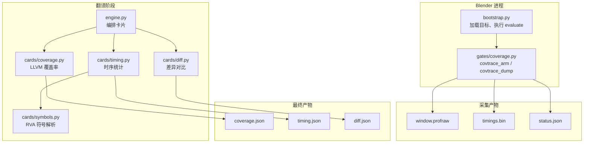
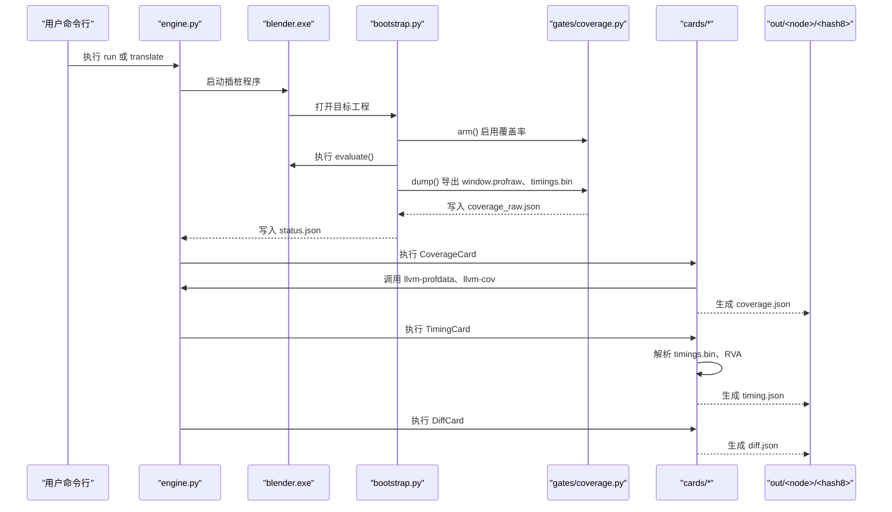
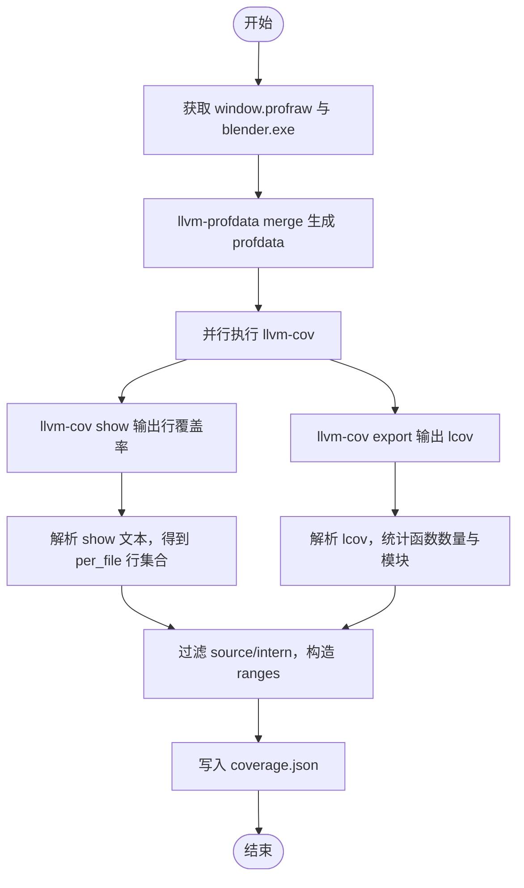
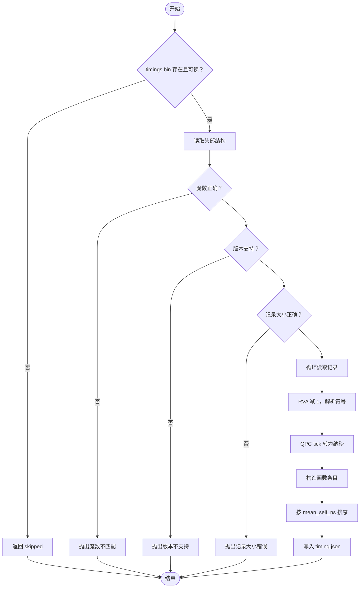
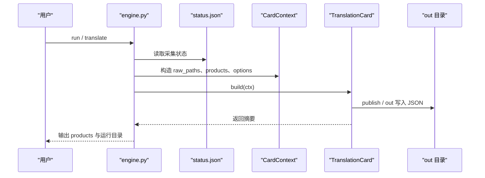
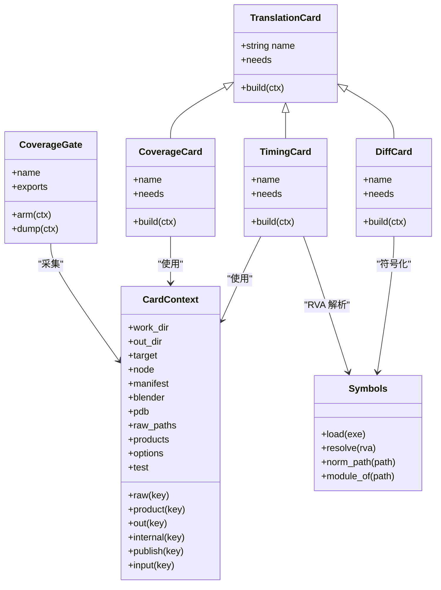

# 覆盖率卡片与时序卡片

<cite>
**本文引用的文件**   
- [cards/coverage.py](file://cards/coverage.py)
- [cards/timing.py](file://cards/timing.py)
- [gates/coverage.py](file://gates/coverage.py)
- [cards/base.py](file://cards/base.py)
- [cards/diff.py](file://cards/diff.py)
- [cards/symbols.py](file://cards/symbols.py)
- [directories.py](file://directories.py)
- [engine.py](file://engine.py)
- [bootstrap.py](file://bootstrap.py)
</cite>

## 目录
1. [引言](#引言)
2. [项目结构](#项目结构)
3. [核心组件](#核心组件)
4. [架构总览](#架构总览)
5. [详细组件分析](#详细组件分析)
6. [依赖关系分析](#依赖关系分析)
7. [性能考虑](#性能考虑)
8. [故障排查指南](#故障排查指南)
9. [结论](#结论)

## 引言
本文说明覆盖率卡片与时序卡片的完整处理流程：
- 覆盖率卡片消费 `window.profraw`，通过 LLVM 工具链生成 `coverage.json`，并聚焦 `source/`、`intern/` 源码行覆盖率。
- 时序卡片消费 `timings.bin`，累计每个函数或边的调用次数、自耗时与包含耗时，生成 `timing.json`。
- 说明 `llvm-cov`、`llvm-profdata` 在流水线中的作用，以及原始数据缺失、时间戳不一致、源路径变化时的处理策略。
- 解释 `coverage.json`、`timing.json` 与 `functions.jsonl`、`diff.json` 的消费关系，并给出测试回归常用字段示例。

## 项目结构
本次文档涉及的关键模块位于以下位置：
- 卡片层：`cards/coverage.py`、`cards/timing.py`、`cards/diff.py`、`cards/base.py`、`cards/symbols.py`
- 闸门层：`gates/coverage.py`
- 引擎层：`engine.py`、`bootstrap.py`
- 目录与工具路径：`directories.py`

**图表来源**
- [bootstrap.py:1-192](file://bootstrap.py#L1-L192)
- [gates/coverage.py:1-39](file://gates/coverage.py#L1-L39)
- [engine.py:200-562](file://engine.py#L200-L562)
- [cards/coverage.py:1-233](file://cards/coverage.py#L1-L233)
- [cards/timing.py:1-108](file://cards/timing.py#L1-L108)
- [cards/diff.py:1-141](file://cards/diff.py#L1-L141)
- [cards/symbols.py:1-200](file://cards/symbols.py#L1-L200)

**章节来源**
- [bootstrap.py:1-192](file://bootstrap.py#L1-L192)
- [gates/coverage.py:1-39](file://gates/coverage.py#L1-L39)
- [engine.py:200-562](file://engine.py#L200-L562)

## 核心组件
- **覆盖率闸门**：负责在 Blender 求值前启用覆盖率收集，并在求值后导出 `window.profraw`，同时写入 `coverage_raw.json`。
- **覆盖率卡片**：把 `window.profraw` 转换为 `coverage.json`，保留 `source/`、`intern/` 的行覆盖范围，并汇总函数数量与模块分布。
- **时序卡片**：读取 `timings.bin`，使用 PDB 把 RVA 解析为函数名、文件和行号，输出 `timing.json`。
- **差异卡片**：基于当前运行与上一次运行的 `functions.bin`、`edges.bin` 或 `edge.json`，计算新增和删除的函数与边，生成 `diff.json`。
- **符号解析器**：通过 Windows `dbghelp.dll` 从 PDB 中解析 RVA、文件名、行号和模块名称。

**章节来源**
- [gates/coverage.py:1-39](file://gates/coverage.py#L1-L39)
- [cards/coverage.py:1-233](file://cards/coverage.py#L1-L233)
- [cards/timing.py:1-108](file://cards/timing.py#L1-L108)
- [cards/diff.py:1-141](file://cards/diff.py#L1-L141)
- [cards/symbols.py:1-200](file://cards/symbols.py#L1-L200)

## 架构总览
整体流水线分为两个阶段：
1. **采集阶段**：由 `engine.py` 启动插桩版 Blender，执行 `bootstrap.py`，加载目标工程，注册并激活闸门，运行求值脚本，最后按闸门顺序 dump 原始数据。
2. **翻译阶段**：`engine.py` 根据已生成的 `status.json` 与 raw 路径，依次执行各卡片，产出 `coverage.json`、`timing.json`、`diff.json` 等 JSON 产物。

**图表来源**
- [engine.py:200-562](file://engine.py#L200-L562)
- [bootstrap.py:1-192](file://bootstrap.py#L1-L192)
- [gates/coverage.py:1-39](file://gates/coverage.py#L1-L39)
- [cards/coverage.py:1-233](file://cards/coverage.py#L1-L233)
- [cards/timing.py:1-108](file://cards/timing.py#L1-L108)
- [cards/diff.py:1-141](file://cards/diff.py#L1-L141)

## 详细组件分析

### 覆盖率闸门：如何生产 `window.profraw`
`CoverageGate` 是覆盖率数据的采集入口：
- `arm()`：调用底层 `covtrace_arm`，传入工作目录下 `window.profraw` 的路径，让 Blender 在运行时记录覆盖率原始数据。
- `dump()`：调用 `covtrace_dump("NUL")`，将覆盖率数据落盘；若返回码非零则抛出异常。
- 成功后写入 `coverage_raw.json`，其中 `raw.coverage` 指向 `window.profraw` 的绝对路径。

该闸门由 `bootstrap.py` 在加载闸门列表后统一 `arm()`，并在 `evaluate()` 结束后反向 `dump()`。

**章节来源**
- [gates/coverage.py:1-39](file://gates/coverage.py#L1-L39)
- [bootstrap.py:1-192](file://bootstrap.py#L1-L192)

### 覆盖率卡片：从 `profraw` 到 `coverage.json`
`CoverageCard` 的职责是把原始覆盖率数据转成面向人类和自动化测试的 JSON。

#### 关键步骤
1. 从上下文获取 `window.profraw` 与 Blender 可执行文件路径。
2. 使用临时目录保存中间产物，避免污染工作目录。
3. 调用 `llvm-profdata merge -sparse` 把 `profraw` 合并为 `blender.profdata`。
4. 并行执行两条 LLVM 子任务：
   - `llvm-cov show`：输出逐行覆盖率文本。
   - `llvm-cov export --format=lcov`：输出 LCOV，用于统计函数数量与模块分布。
5. 解析 `show` 输出，得到每个文件的命中行集合。
6. 解析 LCOV，过滤 `keep_file()` 匹配的文件，统计函数数量、头文件数量、按模块分组数量。
7. 构建结果，包括元数据和按文件组织的行区间列表。
8. 输出 `coverage.json`。

#### LLVM 工具链的作用
- `llvm-profdata`：将多个 `profraw` 片段合并为统一的 `profdata`，供后续工具消费。
- `llvm-cov show`：以可读文本形式输出每行覆盖率计数，用于生成行区间。
- `llvm-cov export`：以 LCOV 格式导出覆盖率，便于复用已有函数级统计逻辑。

#### 源文件路径处理策略
- `SOURCE_DIR` 来自 `directories.py`，默认指向 `blender-4.5.0`。
- `to_rel()` 会把绝对路径去掉 `SOURCE_DIR` 前缀，形成相对路径。
- `keep_file()` 只保留 `source/`、`intern/` 开头的路径。
- `export_lcov()` 使用正则只包含 `blender-4.5.0/source|intern`，减少无关编译树噪声。
- `norm_path()` 与 `module_of()` 会规范化路径并提取模块名，例如 `/source/blender/...` 对应模块 `blender`。

**图表来源**
- [cards/coverage.py:1-233](file://cards/coverage.py#L1-L233)
- [directories.py:1-25](file://directories.py#L1-L25)

#### `coverage.json` 的典型字段
- `meta.source_root`：源码根目录，用于定位相对路径。
- `meta.generated`：卡片生成时间。
- `meta.scanned_files`：扫描到的源文件数。
- `meta.file_count`：进入结果的源文件数。
- `meta.line_count`：命中的行数。
- `meta.eval_only`：是否仅评估模式（不过滤路径）。
- `meta.function_count`：保留的函数数量。
- `meta.function_count_all`：全部函数数量。
- `meta.function_count_source`：排除头文件后的函数数量。
- `meta.function_count_header`：头文件函数数量。
- `meta.function_count_modules`：按模块分组的函数数量。
- `files.<rel_path>.count`：该文件命中行数。
- `files.<rel_path>.ranges`：连续行区间数组，例如 `[[10,12],[20,20]]`。

**章节来源**
- [cards/coverage.py:1-233](file://cards/coverage.py#L1-L233)
- [directories.py:1-25](file://directories.py#L1-L25)

### 时序卡片：从 `timings.bin` 到 `timing.json`
`TimingCard` 消费 `gates/coverage.py` 或其他采集逻辑产出的 `timings.bin`。

#### 二进制格式
- 头部结构：魔数、版本、频率、记录大小、记录数。
- 每条记录：键、调用次数、自耗时 QPC tick、包含耗时 QPC tick。
- 键是 RVA+1，因此还原 RVA 时需要减 1。

#### 处理流程
1. 检查 `timings.bin` 是否存在且足够大。
2. 校验魔数、版本、记录大小。
3. 遍历记录，跳过无效键或零调用次数。
4. 调用 `symbols.load(blender)` 加载 PDB。
5. 对每条记录进行 RVA 解析，得到函数名、文件、行号、模块。
6. 将 QPC tick 换算为纳秒，计算平均耗时。
7. 按平均自耗时排序，生成 `timing.json`。

**图表来源**
- [cards/timing.py:1-108](file://cards/timing.py#L1-L108)
- [cards/symbols.py:1-200](file://cards/symbols.py#L1-L200)

#### `timing.json` 的典型字段
- `meta.blender`：使用的 Blender 可执行路径。
- `meta.timings_bin`：原始时序文件名。
- `meta.qpc_freq`：QPC 频率。
- `meta.records`：有效记录条数。
- `meta.functions`：成功解析到的函数条数。
- `meta.total_calls`：所有函数的调用次数总和。
- `meta.sorted_by`：排序方式，通常是 `mean_self_ns`。
- `meta.generated`：生成时间。
- `functions[].rva`：函数 RVA。
- `functions[].name`：函数名。
- `functions[].file`：规范化后的源文件路径。
- `functions[].line`：行号。
- `functions[].module`：模块名。
- `functions[].count`：调用次数。
- `functions[].total_self_ns`：自耗时总计纳秒。
- `functions[].total_inclusive_ns`：包含耗时总计纳秒。
- `functions[].mean_self_ns`：平均自耗时纳秒。
- `functions[].mean_inclusive_ns`：平均包含耗时纳秒。
- `functions[].self_share`：自耗时占比。

**章节来源**
- [cards/timing.py:1-108](file://cards/timing.py#L1-L108)
- [cards/symbols.py:1-200](file://cards/symbols.py#L1-L200)

### 差异卡片：`functions.jsonl`、`diff.json` 与回归
`DiffCard` 用于对比“当前运行”和“上一次运行”的差异，常用于回归检测。

#### 输入来源
- 当前运行：优先读取 `edge.json`，否则用 `functions.bin`、`edges.bin` 与 PDB 符号化。
- 历史运行：可通过 `options.diff_against` 指定缓存目录或输出目录。
- 历史运行支持两种格式：
  - 直接读取 `edge.json`。
  - 读取 `functions.bin`、`edges.bin`，再用 `symbols.symbolize(..., with_addresses=True)` 重建带 RVA 的数据。

#### 差异计算
- 从函数表按 RVA 建索引。
- 从边表提取 `(caller_rva, callee_rva)` 集合。
- 计算新增函数、删除函数、新增边、删除边。
- 去重边时按 `(caller_name, callee_name)` 归一化。
- 可选读取 `eval` 节点测量信息，写入 `meta.measure_node`。

#### `diff.json` 的典型字段
- `meta.before`：历史运行目录。
- `meta.after`：当前运行目录。
- `meta.before_functions`、`meta.after_functions`：函数数量。
- `meta.before_edges`、`meta.after_edges`：边数量。
- `added.functions`、`removed.functions`：新增或删除函数列表。
- `added.edges`、`removed.edges`：新增或删除边列表。
- `added.function_count`、`removed.function_count`：函数差异数量。
- `added.edge_count_raw`、`removed.edge_count_raw`：原始边差异数量。
- `added.edge_count_dedup`、`removed.edge_count_dedup`：去重后边差异数量。

**章节来源**
- [cards/diff.py:1-141](file://cards/diff.py#L1-L141)
- [cards/symbols.py:1-200](file://cards/symbols.py#L1-L200)

### 引擎编排与 raw 生命周期
`engine.py` 负责：
- 启动 Blender 并注入环境变量 `LLVM_PROFILE_FILE=NUL`，避免 LLVM 自身覆盖率干扰。
- 校验采集结果，若 `window.profraw` 为空或缺失，会提示“采集结果异常”。
- 将 gates 的 raw 数据写入 manifest，并传给卡片上下文。
- 按卡片依赖执行翻译，并把产品路径写回 `products`。
- 支持 `translate` 子命令：直接从 cache 重新生成 JSON，不再启动 Blender。

**图表来源**
- [engine.py:200-562](file://engine.py#L200-L562)
- [cards/base.py:1-63](file://cards/base.py#L1-L63)

**章节来源**
- [engine.py:200-562](file://engine.py#L200-L562)
- [cards/base.py:1-63](file://cards/base.py#L1-L63)

## 依赖关系分析

**图表来源**
- [cards/base.py:1-63](file://cards/base.py#L1-L63)
- [cards/coverage.py:1-233](file://cards/coverage.py#L1-L233)
- [cards/timing.py:1-108](file://cards/timing.py#L1-L108)
- [cards/diff.py:1-141](file://cards/diff.py#L1-L141)
- [cards/symbols.py:1-200](file://cards/symbols.py#L1-L200)
- [gates/coverage.py:1-39](file://gates/coverage.py#L1-L39)

**章节来源**
- [cards/base.py:1-63](file://cards/base.py#L1-L63)
- [cards/coverage.py:1-233](file://cards/coverage.py#L1-L233)
- [cards/timing.py:1-108](file://cards/timing.py#L1-L108)
- [cards/diff.py:1-141](file://cards/diff.py#L1-L141)
- [cards/symbols.py:1-200](file://cards/symbols.py#L1-L200)
- [gates/coverage.py:1-39](file://gates/coverage.py#L1-L39)

## 性能考虑
- 覆盖率卡片并行执行 `llvm-cov show` 与 `llvm-cov export`，利用双线程缩短 LLVM 工具链等待时间。
- `profdata merge -sparse` 能减少稀疏覆盖率数据的体积和合并开销。
- 覆盖率结果默认只保留 `source/`、`intern/`，避免无关头文件和第三方库放大 JSON。
- 时序卡片按平均自耗时排序，适合快速定位热点函数。
- 差异卡片先按 RVA 建索引，再比较集合，复杂度主要取决于函数数和边数。

[本节为通用性能建议，不直接分析具体代码行]

## 故障排查指南

### LLVM_BIN_DIR 配置错误
- 现象：`llvm-cov`、`llvm-profdata` 找不到，覆盖率卡片在执行 LLVM 子进程时报错。
- 原因：`directories.py` 中 `LLVM_BIN_DIR` 指向本地固定路径，不同机器可能不存在对应工具。
- 修复方法：
  - 修改 `directories.py` 的 `LLVM_BIN_DIR` 为当前机器上 `llvm-cov.exe`、`llvm-profdata.exe` 所在目录。
  - 确保两个工具均可执行，并与安装版本一致。
  - 如果 CI 环境动态安装 LLVM，应在部署阶段把工具放入该目录或通过构建脚本重写路径。

**章节来源**
- [directories.py:1-25](file://directories.py#L1-L25)
- [cards/coverage.py:1-233](file://cards/coverage.py#L1-L233)

### `window.profraw` 为空或缺失
- 现象：
  - 采集阶段失败，或引擎提示“采集结果异常：window.profraw 为空或缺失”。
  - 覆盖率卡片无法继续，因为缺少 raw 输入。
- 可能原因：
  - 未启用覆盖率闸门。
  - `covtrace_arm` 路径或参数错误。
  - `covtrace_dump` 返回非零。
  - Blender 求值过程没有触发覆盖率相关路径。
  - `LLVM_PROFILE_FILE` 被外部覆盖。
- 修复方法：
  - 确认使用了插桩版 Blender，并注册了 `coverage` 闸门。
  - 检查 `coverage_raw.json` 中 `raw.coverage` 是否存在且非空。
  - 检查 `covtrace_dump` 返回值。
  - 确保 `bootstrap.py` 设置 `LLVM_PROFILE_FILE=NUL`，避免其他覆盖率工具干扰。
  - 扩大被测用例，使覆盖率路径确实被执行。

**章节来源**
- [gates/coverage.py:1-39](file://gates/coverage.py#L1-L39)
- [engine.py:200-562](file://engine.py#L200-L562)
- [bootstrap.py:1-192](file://bootstrap.py#L1-L192)

### 覆盖率结果为空
- 现象：`coverage.json` 存在但 `meta.file_count`、`meta.line_count`、`meta.function_count` 很小甚至为零。
- 可能原因：
  - `SOURCE_DIR` 与实际源码目录不一致，导致路径无法匹配。
  - `keep_file()` 过滤掉所有文件，只保留 `source/`、`intern/`。
  - `export_lcov` 的正则只包含 `blender-4.5.0/source|intern`。
  - `llvm-cov show` 或 `llvm-cov export` 执行失败，但未及时暴露。
  - 构建产物与源码树不一致。
- 修复方法：
  - 检查 `directories.py` 的 `SOURCE_DIR` 是否指向真实源码根。
  - 如果是回归测试需要全部路径，使用 `--keep-all` 开启 `coverage_keep_all`。
  - 检查 `blender-4.5.0` 前缀是否与实际构建目录一致。
  - 查看临时目录日志，确认 LLVM 工具链是否正常输出。

**章节来源**
- [cards/coverage.py:1-233](file://cards/coverage.py#L1-L233)
- [directories.py:1-25](file://directories.py#L1-L25)
- [engine.py:200-562](file://engine.py#L200-L562)

### 耗时统计不准确
- 现象：`timing.json` 中 `mean_self_ns`、`mean_inclusive_ns` 异常小或异常大。
- 可能原因：
  - `timings.bin` 魔数、版本或记录大小不匹配。
  - QPC 频率异常。
  - 采样过程中时钟频率发生变化。
  - RVA 未解析到函数，导致某些记录被丢弃。
  - 多次运行混合不同 PDB 或不同构建产物。
- 修复方法：
  - 确认 `timings.bin` 头部合法。
  - 检查 `meta.qpc_freq` 是否为合理正数。
  - 确保一次回归只对比相同 Blender、相同 PDB、相同构建。
  - 检查 `symbols.load(blender)` 是否能正确加载 PDB。
  - 若函数名为空，检查 RVA 是否落在已知符号范围内。

**章节来源**
- [cards/timing.py:1-108](file://cards/timing.py#L1-L108)
- [cards/symbols.py:1-200](file://cards/symbols.py#L1-L200)

### 时间戳不一致
- 现象：同一份 raw 在不同时间生成 `coverage.json` 或 `timing.json`，但内容基本一致。
- 处理方式：
  - 两个 JSON 的 `meta.generated` 是字符串时间戳，用于人类阅读和排序，不参与功能逻辑。
  - 差异卡片比较的是函数 RVA 与边集合，而不是生成时间。
  - 如果需要稳定比对，应忽略 `generated` 字段，或在使用 diff 前标准化时间戳。

**章节来源**
- [cards/coverage.py:1-233](file://cards/coverage.py#L1-L233)
- [cards/timing.py:1-108](file://cards/timing.py#L1-L108)
- [cards/diff.py:1-141](file://cards/diff.py#L1-L141)

### 源文件路径变化
- 现象：旧缓存迁移到新机器后，覆盖率或时序 JSON 中的路径不可用。
- 处理方式：
  - `coverage.json` 使用相对路径，相对于 `meta.source_root`。
  - `timing.json` 使用 `symbols.norm_path()` 规范化路径，尽量去掉 `blender-4.5.0/` 前缀。
  - `engine.py` 在保存 manifest 时会尝试 rebase raw 路径，将 work_dir 映射到 cache_dir。
  - 如果源码树结构变化，应重新生成 JSON，不要直接复用旧缓存。
  - 如果只移动目录但源码树不变，可信任 rebase 后的路径；若仍失败，使用 `engine.py translate` 重新翻译。

**章节来源**
- [cards/coverage.py:1-233](file://cards/coverage.py#L1-L233)
- [cards/symbols.py:1-200](file://cards/symbols.py#L1-L200)
- [engine.py:200-562](file://engine.py#L200-L562)

## 结论
覆盖率卡片与时序卡片共同构成 CovTrace 的观测能力：
- 覆盖率卡片通过 LLVM 工具链把 `window.profraw` 转成结构化行覆盖 JSON，聚焦 `source/`、`intern/`，适合回归测试判断源码变更是否影响关键路径。
- 时序卡片把 `timings.bin` 中的 QPC tick 转化为纳秒，结合 PDB 提供函数级热点视图。
- 差异卡片基于 RVA 与边集合，提供稳定的回归对比结果。
- 在实际使用中，应确保 LLVM 工具链路径正确、`window.profraw` 非空、PDB 与 Blender 版本一致，并通过 `engine.py run` 与 `engine.py translate` 分离采集与翻译阶段，提高稳定性与可重复性。

[本节为总结性内容，不直接分析具体代码行]