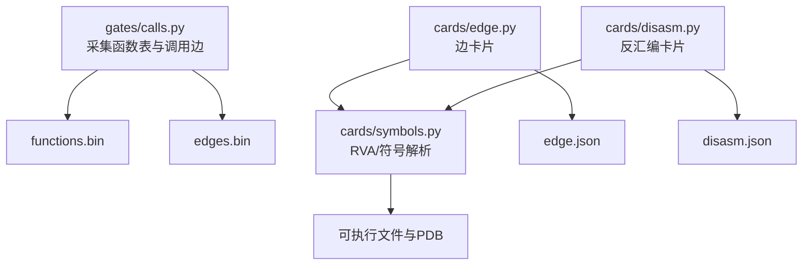
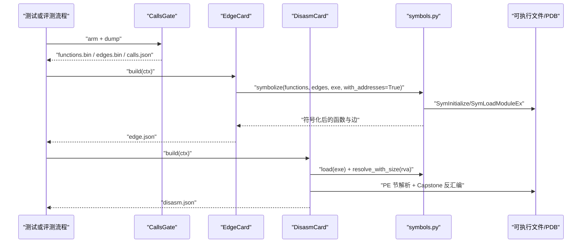
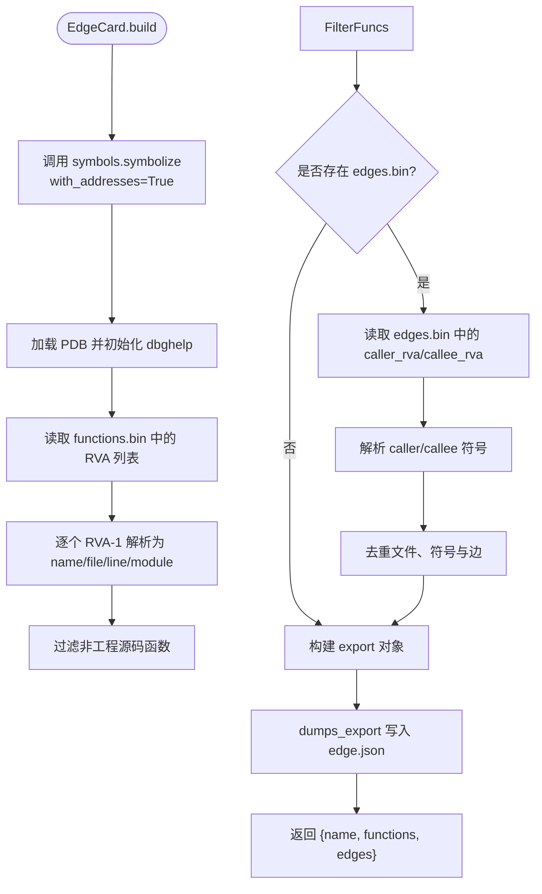
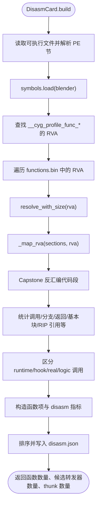
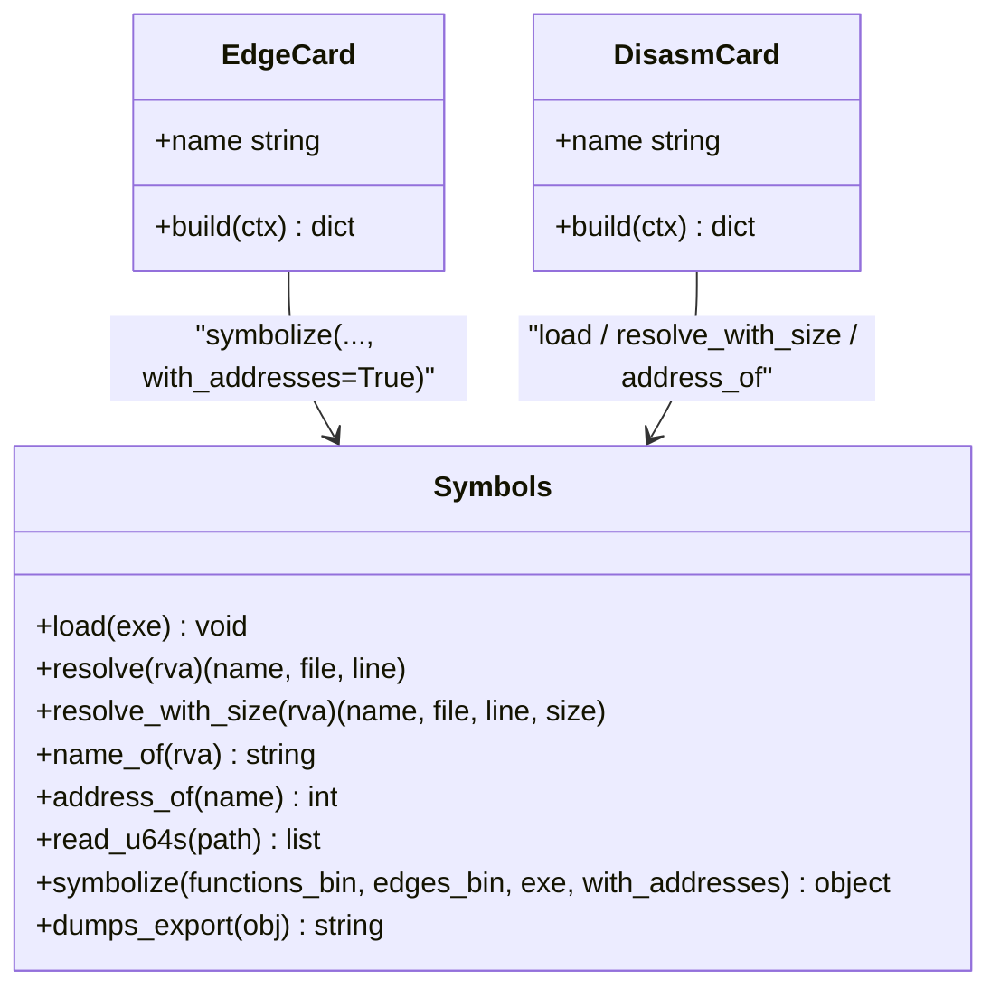
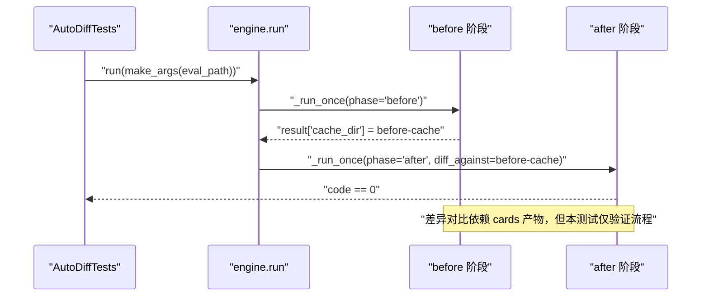
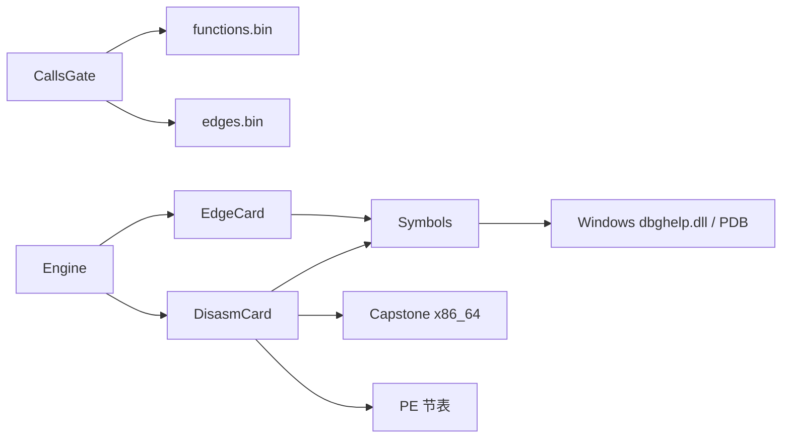

# 边卡片与反汇编卡片

<cite>
**本文引用的文件**   
- [cards/edge.py](file://cards/edge.py)
- [cards/disasm.py](file://cards/disasm.py)
- [gates/calls.py](file://gates/calls.py)
- [cards/symbols.py](file://cards/symbols.py)
- [tests/test_auto_diff.py](file://tests/test_auto_diff.py)
- [engine.py](file://engine.py)
</cite>

## 目录
1. [引言](#引言)
2. [项目结构中的相关位置](#项目结构中的相关位置)
3. [核心组件总览](#核心组件总览)
4. [架构概览](#架构概览)
5. [边卡片分析](#边卡片分析)
6. [反汇编卡片分析](#反汇编卡片分析)
7. [RVA 身份与符号解析](#rva-身份与符号解析)
8. [数据模型与示例](#数据模型与示例)
9. [差异对比流程关系](#差异对比流程关系)
10. [依赖分析](#依赖分析)
11. [性能考虑](#性能考虑)
12. [故障排查指南](#故障排查指南)
13. [结论](#结论)

## 引言
本文聚焦两个输出卡片：
- **边卡片**：消费 `gates/calls.py` 产出的原始函数表与调用边，结合 Windows PDB/dbghelp 符号信息，构建 caller/callee 关系并写出 `edge.json`。
- **反汇编卡片**：基于可执行文件的 PE 节信息与 Capstone 反汇编结果，将函数 RVA 映射为可读的反汇编统计信息，并写出 `disasm.json`。

这两个卡片都依赖 `cards/symbols.py` 提供的 RVA、符号名、源码路径、行号及代码大小等信息；其中 `edge.json` 还包含显式地址字段，而 `disasm.json` 侧重二进制层面的静态度量。

## 项目结构中的相关位置
- `gates/calls.py`：在受测进程内通过 C 接口收集函数入口 RVA、调用边和时序，产出 `functions.bin`、`edges.bin`、`timings.bin` 以及摘要 `calls.json`。
- `cards/edge.py`：读取 `raw:functions` 与 `raw:edges`，调用符号系统生成结构化导出对象，最终写入 `edge.json`。
- `cards/disasm.py`：读取可执行文件、加载符号、按 RVA 反汇编函数体，输出 `disasm.json`。
- `cards/symbols.py`：封装 dbghelp、PE 节解析、RVA 到名称/文件/行号/大小/模块的转换。
- `tests/test_auto_diff.py`：验证引擎“before/after”差异对比流程，是边卡片与反汇编卡片用于回归对比的上层测试场景。
- `engine.py`：编排闸门、卡片与产物，并提供失败诊断逻辑。

**图示来源**
- [gates/calls.py:1-63](file://gates/calls.py#L1-L63)
- [cards/edge.py:1-23](file://cards/edge.py#L1-L23)
- [cards/disasm.py:1-393](file://cards/disasm.py#L1-L393)
- [cards/symbols.py:1-373](file://cards/symbols.py#L1-L373)

**章节来源**
- [gates/calls.py:1-63](file://gates/calls.py#L1-L63)
- [cards/edge.py:1-23](file://cards/edge.py#L1-L23)
- [cards/disasm.py:1-393](file://cards/disasm.py#L1-L393)
- [cards/symbols.py:1-373](file://cards/symbols.py#L1-L373)

## 核心组件总览
| 组件 | 主要职责 | 输入 | 输出 | 关键外部依赖 |
|---|---|---|---|---|
| `CallsGate` | 在受测进程中启用调用追踪，导出原始函数表与调用边 | 运行中的目标程序 | `functions.bin`、`edges.bin`、`timings.bin`、`calls.json` | C 侧 `covtrace_calls_*` 接口 |
| `EdgeCard` | 将 raw RVA 对转换为带符号信息的边集合 | `raw:functions`、`raw:edges` | `edge.json` | `symbols.symbolize`、dbghelp/PDB |
| `DisasmCard` | 根据 RVA 反汇编函数体，计算指令级指标 | `raw:functions`、PE 可执行文件 | `disasm.json` | Capstone、PE 节解析、dbghelp/PDB |
| `symbols` | RVA → 名称/文件/行号/大小/模块，导出统一结构 | RVA 列表、exe | 标准化函数/边/文件索引 | Windows `dbghelp.dll`、kernel32 |

**章节来源**
- [gates/calls.py:1-63](file://gates/calls.py#L1-L63)
- [cards/edge.py:1-23](file://cards/edge.py#L1-L23)
- [cards/disasm.py:1-393](file://cards/disasm.py#L1-L393)
- [cards/symbols.py:1-373](file://cards/symbols.py#L1-L373)

## 架构概览
整体处理链路分为三层：
1. **采集层**：`CallsGate` 在受测程序中注入回调，记录函数入口 RVA 与调用边。
2. **符号化层**：`symbols.py` 使用 dbghelp 加载 PDB，把 RVA 解析为可读符号、源文件和行号。
3. **卡片层**：`EdgeCard` 与 `DisasmCard` 分别消费 raw 数据，生成面向分析的 JSON。

**图示来源**
- [gates/calls.py:1-63](file://gates/calls.py#L1-L63)
- [cards/edge.py:1-23](file://cards/edge.py#L1-L23)
- [cards/disasm.py:1-393](file://cards/disasm.py#L1-L393)
- [cards/symbols.py:1-373](file://cards/symbols.py#L1-L373)

## 边卡片分析
### 输入与依赖
- `EdgeCard.name = "edge"`。
- `needs = ("raw:functions", "raw:edges")`，即必须存在 `functions.bin` 与 `edges.bin`。
- 它不直接读二进制，而是通过 `symbols.symbolize(...)` 完成 RVA 到符号结构的转换。

### 构建过程
1. 调用 `symbols.symbolize(functions_bin, edges_bin, blender_exe, with_addresses=True)`。
2. 该函数会：
   - 加载 PDB。
   - 从 `functions.bin` 读取 u64 RVA 序列。
   - 把每个 RVA 减一后作为实际 RVA 查询符号。
   - 过滤掉非工程源码路径的函数。
   - 如果存在 `edges.bin`，则逐条解析高 32 位 caller RVA 和低 32 位 callee RVA。
   - 构建去重后的文件表、符号表、边表，并生成元数据。
3. 使用 `symbols.dumps_export(obj)` 输出紧凑但可读的 JSON。
4. 返回摘要，包含 `name`、`functions` 数量与 `edges` 数量。

**图示来源**
- [cards/edge.py:1-23](file://cards/edge.py#L1-L23)
- [cards/symbols.py:201-373](file://cards/symbols.py#L201-L373)

**章节来源**
- [cards/edge.py:1-23](file://cards/edge.py#L1-L23)
- [cards/symbols.py:201-373](file://cards/symbols.py#L201-L373)

## 反汇编卡片分析
### 输入与依赖
- `DisasmCard.name = "disasm"`。
- `needs = ("raw:functions",)`，只需要函数 RVA 列表。
- 需要读取 `ctx.blender` 对应的可执行文件，并通过 Capstone 对 x86_64 进行反汇编。

### 构建过程
1. 读取整个可执行文件，解析 PE 头与节表，得到 `image_base` 与节映射。
2. 调用 `symbols.load(blender_exe)` 加载 PDB。
3. 查找 instrumentation hook 符号（例如 `__cyg_profile_func_enter`、`__cyg_profile_func_exit`）的 RVA，用于识别覆盖率插桩调用。
4. 遍历 `raw:functions` 中每个 u64 值：
   - 将其减一作为 RVA。
   - 通过 `symbols.resolve_with_size(rva)` 获取函数名、源码路径、行号和 PDB 提供的 size。
   - 若没有符号名则跳过。
   - 通过 `_map_rva` 定位函数在 PE 文件中的偏移与可用字节数。
   - 用 Capstone 反汇编最多 `MAX_FUNC_BYTES` 字节。
   - 统计指令数、调用、分支、返回、基本块、回边、switch table、栈帧大小、RIP 相对引用、全局引用、FP/SIMD 指令、lock 指令等。
   - 区分 direct call、indirect call、runtime call、hook call，并计算 `real_calls` 与 `logic_calls`。
   - 判断是否为 tiny 函数、branchless 函数、forwarder candidate、tail thunk。
5. 输出 `disasm.json`，包含 `meta` 与 `functions` 数组。

**图示来源**
- [cards/disasm.py:1-393](file://cards/disasm.py#L1-L393)
- [cards/symbols.py:1-373](file://cards/symbols.py#L1-L373)

**章节来源**
- [cards/disasm.py:1-393](file://cards/disasm.py#L1-L393)
- [cards/symbols.py:1-373](file://cards/symbols.py#L1-L373)

## RVA 身份与符号解析
### RVA 身份
- 在 `gates/calls.py` 与 `cards/symbols.py` 中，原始 RVA 被存储为小端 u64。
- 在 `symbols.symbolize` 与 `DisasmCard.build` 中，读取到的值会被减一，再作为真实 RVA 查询符号。
- 因此，“RVA 身份”可以理解为：**原始 raw 值减一后对应的模块内偏移**。这个约定贯穿函数表和边表。

### symbols.py 的工作方式
- 通过 `ctypes` 调用 Windows `dbghelp.dll`。
- `load(exe)` 设置符号选项，调用 `SymInitializeW` 与 `SymLoadModuleExW`。
- `resolve(rva)` 将 RVA 转为虚拟地址，调用 `SymFromAddrW` 取符号名，再用 `SymGetLineFromAddr64` 取文件名和行号。
- `resolve_with_size(rva)` 额外返回 PDB 中的函数 size。
- `name_of(rva)` 返回精确匹配 RVA 的符号名。
- `address_of(name)` 通过 `SymFromNameW` 反向查找符号 RVA，用于识别 instrumentation hook。
- `read_u64s(path)` 把二进制文件按 8 字节小端整数解析。
- `norm_path`、`is_project`、`module_of` 负责路径规范化、工程路径过滤与模块划分。

**图示来源**
- [cards/symbols.py:1-373](file://cards/symbols.py#L1-L373)
- [cards/edge.py:1-23](file://cards/edge.py#L1-L23)
- [cards/disasm.py:1-393](file://cards/disasm.py#L1-L393)

**章节来源**
- [cards/symbols.py:1-373](file://cards/symbols.py#L1-L373)
- [cards/edge.py:1-23](file://cards/edge.py#L1-L23)
- [cards/disasm.py:1-393](file://cards/disasm.py#L1-L393)

## 数据模型与示例
### edge.json 的结构
`edge.json` 由 `symbols.dumps_export` 输出，至少包含：
- `meta`：元数据，包括 `exe`、`rva_file`、`total_rvas`、`project_functions`、`generated`、`file_count`、`symbol_count`、`project_symbols`、`dropped_no_file_functions`、`dropped_no_file_edges`、`edge_count`。
- `files`：去重后的源码路径列表。
- `functions`：符号化的函数项列表。
- `edges`：边列表，每条边指向 `functions` 中的索引。

#### edge.json 中函数项示例
一个函数项通常包含：
- `name`：函数名。
- `file`：文件索引，对应 `files` 中的路径。
- `line`：行号。
- `module`：模块名，如 `/source/blender/` 下第一个目录。
- 当 `with_addresses=True` 时，还会包含：
  - `rva`：函数 RVA。
  - `va`：虚拟地址，等于 `MOD_BASE + rva`。

注意：`EdgeCard` 调用 `symbolize(..., with_addresses=True)`，因此 `edge.json` 中的函数项和边项通常会携带 RVA/VA 信息。

#### edge.json 中边项示例
一条边通常包含：
- `caller`：调用方符号在 `functions` 中的索引。
- `callee`：被调方符号在 `functions` 中的索引。
- 当 `with_addresses=True` 时，还可能包含：
  - `caller_rva`。
  - `callee_rva`。

#### edge.json 元数据关键字段
- `edge_count`：边数量，由 `build_export` 在 `has_edges` 时写入。
- `project_functions`：经过工程路径过滤后的函数数量。
- `dropped_no_file_functions`：因无有效文件路径而被丢弃的函数数量。
- `dropped_no_file_edges`：因 caller/callee 文件无效而被丢弃的边数量。

**章节来源**
- [cards/edge.py:1-23](file://cards/edge.py#L1-L23)
- [cards/symbols.py:201-373](file://cards/symbols.py#L201-L373)

### disasm.json 的结构
`disasm.json` 包含：
- `meta`：
  - `blender`：可执行文件路径。
  - `image_base`：PE Optional Header 中的镜像基址。
  - `functions`：反汇编函数数量。
  - `candidates`：forwarder candidate 数量。
  - `thunks`：tail thunk 数量。
  - `max_func_bytes`：最大反汇编字节数。
  - `note`：说明 size/instructions 包含覆盖率插桩指令，`real_calls` 排除 `__cyg_profile_func_*`，`decoded_bytes < size` 表示反汇编被截断。
  - `generated`：生成时间。
- `functions`：每个函数一个对象，包含：
  - `rva`、`name`、`file`、`line`、`module`。
  - `disasm`：详细指标对象。

#### disasm.json 中函数项示例
一个函数项大致包含：
- `rva`：函数 RVA。
- `name`：符号名。
- `file`：规范化后的源码路径。
- `line`：源码行号。
- `module`：模块名。
- `disasm.size`：PDB 给出的函数大小。
- `disasm.instructions`：指令总数。
- `disasm.calls`：总调用数。
- `disasm.direct_calls`、`disasm.indirect_calls`。
- `disasm.hook_calls`、`disasm.runtime_calls`、`disasm.real_calls`、`disasm.logic_calls`。
- `disasm.jumps`、`disasm.conditional_jumps`、`disasm.basic_blocks`、`disasm.back_edges`。
- `disasm.rets`、`disasm.stack_frame_bytes`、`disasm.push_count`。
- `disasm.rip_relative_refs`、`disasm.global_refs`。
- `disasm.fp_simd_insns`、`disasm.lock_insns`。
- `disasm.first`、`disasm.last`、`disasm.first_after_hook`。
- `disasm.tail_target_kind`：`none`、`direct_local`、`direct_external`、`indirect`。
- `disasm.tiny`、`disasm.branchless`、`disasm.forwarder_candidate`、`disasm.tail_thunk`。

**章节来源**
- [cards/disasm.py:1-393](file://cards/disasm.py#L1-L393)

### edge_count 的含义
- `edge_count` 来自 `gates/calls.py` 的 `CallsGate.dump`。
- 它通过 C 侧 `covtrace_calls_edge_count` 获取运行时记录的边数量。
- `calls.json` 中保存该值；`engine.py` 的诊断逻辑会检查 `edge_count == 0`，提示“求值可能没有触发”。
- `edge.json` 中的 `meta.edge_count` 则由 `symbols.build_export` 计算实际写入的边数量，可能与 `calls.json.edge_count` 不同，因为部分边可能因文件路径无效而被丢弃。

**章节来源**
- [gates/calls.py:1-63](file://gates/calls.py#L1-L63)
- [cards/symbols.py:201-373](file://cards/symbols.py#L201-L373)
- [engine.py:1-200](file://engine.py#L1-L200)

## 差异对比流程关系
`tests/test_auto_diff.py` 并不直接测试 `edge.json` 或 `disasm.json` 的内容格式，而是测试引擎的“差异对比流程”：
- `test_node_runs_before_after_and_diff`：当配置了 node 时，先运行一次 `before`，缓存 before 的 cache 目录；再运行一次 `after`，并把 after 的结果与 before 缓存对比。
- `test_no_node_keeps_single_capture`：没有 node 时只保留单次捕获。
- `test_dry_run_keeps_single_capture`：dry run 模式下只执行一次。
- `test_no_raw_removes_before_cache_after_diff`：开启 `no_raw` 时，before 阶段仍创建 before-cache，但在 after 差异完成后删除该缓存。
- `test_before_failure_stops_after`：before 失败时不会继续执行 after。

这意味着边卡片与反汇编卡片的产物可用于前后两次运行的对比，但测试本身关注的是引擎是否按预期调度 before/after 阶段、是否清理缓存、以及失败行为是否正确。

**图示来源**
- [tests/test_auto_diff.py:1-124](file://tests/test_auto_diff.py#L1-L124)

**章节来源**
- [tests/test_auto_diff.py:1-124](file://tests/test_auto_diff.py#L1-L124)

## 依赖分析
### 组件耦合
- `EdgeCard` 强依赖 `symbols.symbolize`，间接依赖 dbghelp/PDB。
- `DisasmCard` 依赖 `symbols.load`、`symbols.resolve_with_size`、`symbols.address_of`，同时依赖 Capstone 和 PE 解析逻辑。
- `gates/calls.py` 独立于 cards，但为两个卡片提供原始数据。
- `engine.py` 编排所有 gate 和 card，并维护 raw/product 依赖关系。

**图示来源**
- [gates/calls.py:1-63](file://gates/calls.py#L1-L63)
- [cards/edge.py:1-23](file://cards/edge.py#L1-L23)
- [cards/disasm.py:1-393](file://cards/disasm.py#L1-L393)
- [cards/symbols.py:1-373](file://cards/symbols.py#L1-L373)
- [engine.py:1-200](file://engine.py#L1-L200)

**章节来源**
- [gates/calls.py:1-63](file://gates/calls.py#L1-L63)
- [cards/edge.py:1-23](file://cards/edge.py#L1-L23)
- [cards/disasm.py:1-393](file://cards/disasm.py#L1-L393)
- [cards/symbols.py:1-373](file://cards/symbols.py#L1-L373)
- [engine.py:1-200](file://engine.py#L1-L200)

## 性能考虑
- **反汇编上限**：每个函数最多反汇编 `MAX_FUNC_BYTES` 字节，避免极大函数拖慢分析。
- **解码错误标记**：如果 `decoded_bytes < size`，`disasm.json` 中会标记 `decode_error`，提示反汇编不完整。
- **符号开销**：每次解析 RVA 都要调用 dbghelp，因此批量函数处理集中在 `symbols.read_u64s` 和循环中。
- **运行时缓存**：反汇编卡片对 runtime 调用目标使用 `runtime_cache`，避免重复查询符号名。
- **节缓存**：对 RIP 相对全局引用使用 `section_cache` 减少重复节名查询。
- **并发**：`engine._run_cards` 使用线程池并行执行 coverage 卡片与其他卡片，但其他卡片之间仍按注册顺序构建。

[本节为通用性能讨论，不直接分析具体代码片段]

## 故障排查指南
### 缺少 PDB 或 dbghelp
**现象**
- `symbols.load` 抛出异常，常见消息包括：
  - `SymInitialize failed`
  - `SymLoadModuleEx failed (missing PDB?)`
- `edge.json` 无法生成函数或边。
- `disasm.json` 无法解析符号，函数数量为 0。

**诊断步骤**
1. 确认可执行文件与 PDB 在同一目录或其搜索路径下。
2. 确认当前平台支持 `dbghelp.dll`，且进程能访问 PDB 文件。
3. 检查 `symbols.load` 抛出的具体异常。
4. 如果只缺 PDB，尝试重新编译带调试信息的版本。
5. 如果 dbghelp 不可用，考虑切换到不依赖 PDB 的分析模式，或使用能提供符号的其他工具链。

**章节来源**
- [cards/symbols.py:1-373](file://cards/symbols.py#L1-L373)

### RVA 无法解析
**现象**
- `symbols.resolve` 或 `resolve_with_size` 返回空符号名。
- `edge.json` 中函数数量较少。
- `disasm.json` 中某些 RVA 被跳过。

**原因**
- RVA 减一后不在任何 PDB 符号范围内。
- 符号名存在但不是精确匹配。
- 源码路径被 `is_project` 过滤为非工程路径。

**诊断步骤**
1. 检查 `edge.json.meta.total_rvas` 与实际 `functions` 数量差异。
2. 检查 `edge.json.meta.project_functions` 与 `dropped_no_file_functions`。
3. 检查 `disasm.json.meta.functions` 是否为 0，确认 `resolve_with_size` 是否能找到符号。
4. 确认 raw RVA 是否符合“raw 值减一”约定。
5. 确认可执行文件与 PDB 是否匹配同一构建产物。

**章节来源**
- [cards/symbols.py:1-373](file://cards/symbols.py#L1-L373)
- [cards/edge.py:1-23](file://cards/edge.py#L1-L23)
- [cards/disasm.py:1-393](file://cards/disasm.py#L1-L393)

### edge 数量为 0
**现象**
- `calls.json.edge_count == 0`。
- `edge.json.meta.edge_count == 0`。
- 边卡片报告 `edges` 数量为 0。

**原因**
- 受测程序没有触发任何被跟踪的函数调用。
- 覆盖率插桩未生效。
- 运行环境没有正确执行被测节点。

**诊断步骤**
1. 查看 `calls.json.edge_count`。
2. 检查 `engine._capture_problem` 的诊断提示：“edge_count == 0（求值可能没有触发）”。
3. 检查 `coverage` 闸门是否产出有效的 `window.profraw`。
4. 确认 `gates/calls.py` 的 `arm` 成功，`dump` 生成了 `functions.bin` 与 `edges.bin`。
5. 检查 `functions.bin` 是否为空或不存在。

**章节来源**
- [gates/calls.py:1-63](file://gates/calls.py#L1-L63)
- [engine.py:1-200](file://engine.py#L1-L200)

### disasm.json 中函数数量为 0
**现象**
- `disasm.json.meta.functions == 0`。

**原因**
- `raw:functions` 为空。
- 所有 RVA 都无法解析为符号名。
- 所有函数都被 `is_project` 过滤。
- PE 文件不是有效 PE 或节映射失败。

**诊断步骤**
1. 检查 `raw:functions` 是否存在且非空。
2. 检查 `symbols.load` 是否成功。
3. 检查 `pe_sections` 是否抛出 “not a PE file”、“missing PE signature” 或未知 magic。
4. 检查 `resolve_with_size` 是否能返回符号名。
5. 检查 `disasm.json.meta.note`，确认是否出现 `decoded_bytes < size` 的反汇编截断提示。

**章节来源**
- [cards/disasm.py:1-393](file://cards/disasm.py#L1-L393)
- [cards/symbols.py:1-373](file://cards/symbols.py#L1-L373)

## 结论
- `EdgeCard` 的核心价值是把 raw RVA 调用边转化为可读的 caller/callee 关系，并通过 `edge.json` 暴露函数、文件、边及元数据。
- `DisasmCard` 的核心价值是从二进制层面补充函数行为特征，通过 `disasm.json` 提供指令级指标、调用分类、基本块与尾调用特征。
- 两者都依赖 `symbols.py` 的 RVA 解析能力；当 PDB/dbghelp 不可用时，符号解析会失败，导致函数或边信息缺失。
- `edge_count` 既是运行时计数器，也是导出后边数量的体现，二者含义略有不同，排查时应同时查看 `calls.json` 与 `edge.json.meta.edge_count`。
- `tests/test_auto_diff.py` 保证差异对比流程的正确性，为边卡片与反汇编卡片提供稳定的 before/after 对比上下文。

[本节为总结性内容，不直接分析具体文件]