# 节点边界检测

<cite>
**本文引用的文件**   
- [bootstrap.py](file://bootstrap.py)
- [frag/backend.py](file://frag/backend.py)
- [frag/targeting.py](file://frag/targeting.py)
- [frag/validate.py](file://frag/validate.py)
- [infra/target.py](file://infra/target.py)
- [cards/diff.py](file://cards/diff.py)
- [registry.py](file://registry.py)
- [engine.py](file://engine.py)
- [eval/template.py](file://eval/template.py)
</cite>

## 目录
1. [引言](#引言)
2. [项目结构中的位置](#项目结构中的位置)
3. [核心组件与职责](#核心组件与职责)
4. [架构总览](#架构总览)
5. [关键流程详解](#关键流程详解)
6. [NODE 字段语义与匹配规则](#node-字段语义与匹配规则)
7. [受限节点类型：Repeat、Foreach、Simulation](#受限节点类型repeatforeachsimulation)
8. [before/after 区域校验失败原因与修复](#beforeafter-区域校验失败原因与修复)
9. [与 diff.json、functions.jsonl 的关系](#与-diffjson-functionsjsonl-的关系)
10. [在 CI 中的回归判定作用](#在-ci-中的回归判定作用)
11. [性能与健壮性建议](#性能与健壮性建议)
12. [故障排查清单](#故障排查清单)
13. [结论](#结论)

## 引言

节点边界检测是这套工具链中用于“精确限定被测几何节点”的机制。它有两个目标：

1. **选择并解析被测节点**：从 Blender 修改器的节点树中，按 NODE 字面量找到待测节点，并确定其几何输入、几何输出以及 Group Output 上的几何输出端口。
2. **在 before/after 阶段临时重连拓扑**：在不破坏原工程的前提下，把被测节点的输出直接连接到 Group Output，或把 Group Input 透传到 Group Output，从而让求值结果只反映该节点的行为。

这个能力由 `frag/targeting.py` 负责节点选择、约束检查和拓扑重连；由 `frag/backend.py` 负责驱动引擎执行验证、求值和产物生成；最终由 `cards/diff.py` 对比前后两次运行结果，写入 `diff.json`，支撑 CI 中的节点级回归判定。

## 项目结构中的位置

| 模块 | 职责 | 与本功能的关联 |
|---|---|---|
| `frag/targeting.py` | Blender 侧的节点选择、区域校验、测量元数据封装和连线重写 | 定义 `Measure`、`TargetError`，实现 `resolve`、`rewire`、`validate_zones` |
| `frag/backend.py` | 非 Blender 进程入口，负责调用引擎进行 validate 和 run | 读取 eval 中的 NODE，构造命令并解析返回信息 |
| `frag/validate.py` | Blender 侧验证入口 | 打开工程后执行 `targeting.validate_zones` 与 `targeting.resolve` |
| `bootstrap.py` | Blender 底座 | 加载 TARGET、定位几何节点修改器、触发 before/after 重连 |
| `infra/target.py` | 不执行脚本地解析 eval 中的 TARGET 和 NODE | AST 解析，提供 `measure_node` |
| `cards/diff.py` | 差异卡片 | 对比前后函数和边集合，输出 `diff.json` |
| `registry.py` | 产品名注册 | 把 `diff.json`、`functions.jsonl` 等产物映射为产品名称 |
| `engine.py` | 编排引擎 | 组合 before/after 运行、diff_against、自动回归流程 |
| `eval/template.py` | 示例求值脚本 | 展示 TARGET 与 NODE 的写法 |

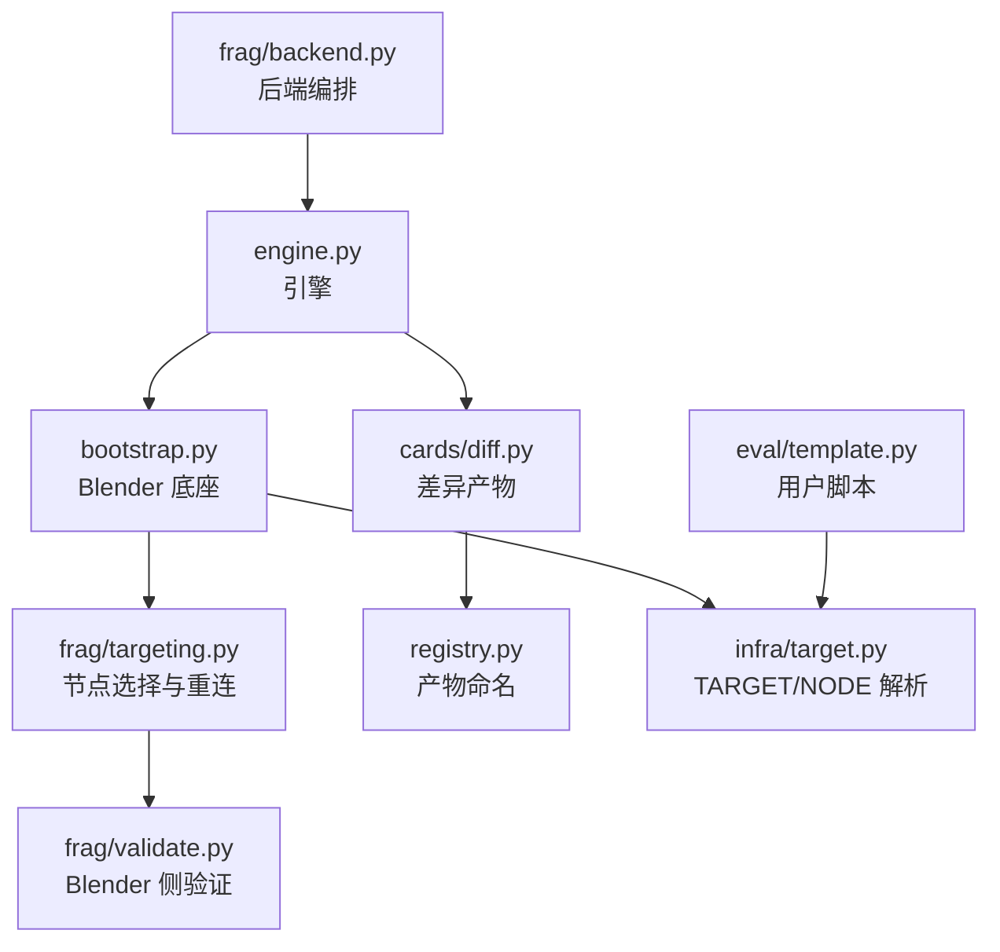

**图表来源**
- [frag/backend.py:1-125](file://frag/backend.py#L1-L125)
- [engine.py:224-273](file://engine.py#L224-L273)
- [bootstrap.py:61-114](file://bootstrap.py#L61-L114)
- [frag/targeting.py:1-136](file://frag/targeting.py#L1-L136)
- [frag/validate.py:1-66](file://frag/validate.py#L1-L66)
- [cards/diff.py:1-141](file://cards/diff.py#L1-L141)
- [registry.py:1-49](file://registry.py#L1-L49)
- [infra/target.py:1-81](file://infra/target.py#L1-L81)
- [eval/template.py:1-25](file://eval/template.py#L1-L25)

**章节来源**
- [frag/backend.py:1-125](file://frag/backend.py#L1-L125)
- [frag/targeting.py:1-136](file://frag/targeting.py#L1-L136)
- [bootstrap.py:1-192](file://bootstrap.py#L1-L192)
- [infra/target.py:1-81](file://infra/target.py#L1-L81)
- [cards/diff.py:1-141](file://cards/diff.py#L1-L141)
- [registry.py:1-49](file://registry.py#L1-L49)
- [engine.py:224-273](file://engine.py#L224-L273)
- [eval/template.py:1-25](file://eval/template.py#L1-L25)

## 核心组件与职责

### targeting.py：节点选择、约束检查、拓扑重连

`frag/targeting.py` 是本功能的核心。它定义了以下关键概念：

- **受限区域类型集合**：包括 Repeat、Simulation、Foreach Geometry Element 的输入和输出节点。这些节点一旦出现在当前节点树或其嵌套组中，会直接触发校验失败。
- **`TargetError`**：所有与节点选择和区域合法性相关的错误统一抛出该异常。
- **`validate_zones(tree)`**：递归扫描节点树，收集受限区域，若存在则拒绝后续操作。
- **`find_measure_node(tree, spec)`**：根据 NODE 字符串查找被测节点，支持 name、label、bl_idname 匹配，并提供去除非字母数字字符后的模糊匹配回退。
- **`_geometry_sockets(node)`**：筛选几何类型的输入和输出端口。
- **`_group_output_socket(tree)`**：要求节点树中只有一个 Group Output，且其中只有一个几何输出端口。
- **`Measure`**：封装被测节点、输入端口、输出端口和 Group Output 端口的元数据。
- **`resolve(tree, spec)`**：完成节点选择、几何输入数量限制、几何输出数量限制，并返回 `Measure`。
- **`rewire(measure, phase)`**：在 before 或 after 阶段临时重写连线。

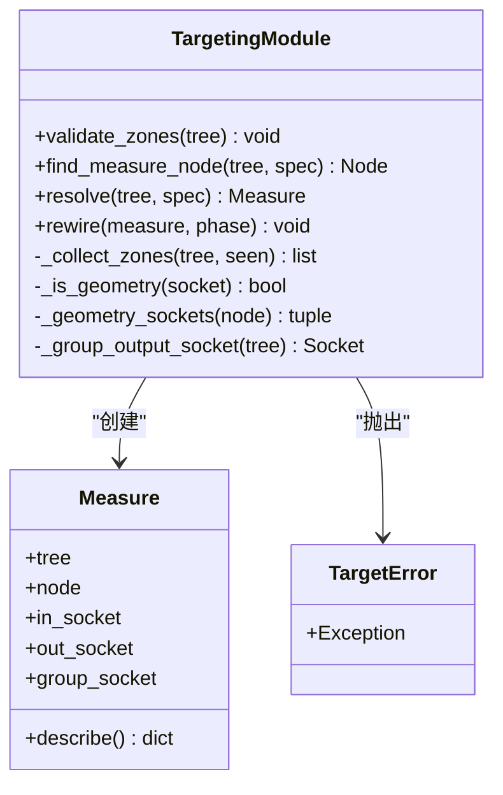

**图表来源**
- [frag/targeting.py:1-136](file://frag/targeting.py#L1-L136)

**章节来源**
- [frag/targeting.py:1-136](file://frag/targeting.py#L1-L136)

### backend.py：后端编排

`frag/backend.py` 不是 Blender 进程，而是宿主 Python 进程。它的作用是：

1. 解析命令行参数，特别是 `--eval`、`--measure-node`、`--node`、`--force` 等。
2. 通过 `infra.target` 加载 eval 脚本中的 TARGET，并读取 NODE。
3. 先调用引擎的 `validate` 子命令进行区域合法性检查。
4. 再调用引擎的 `run` 子命令执行实际求值。
5. 从引擎输出中解析测量信息和运行目录，并打印 diff 产物路径。

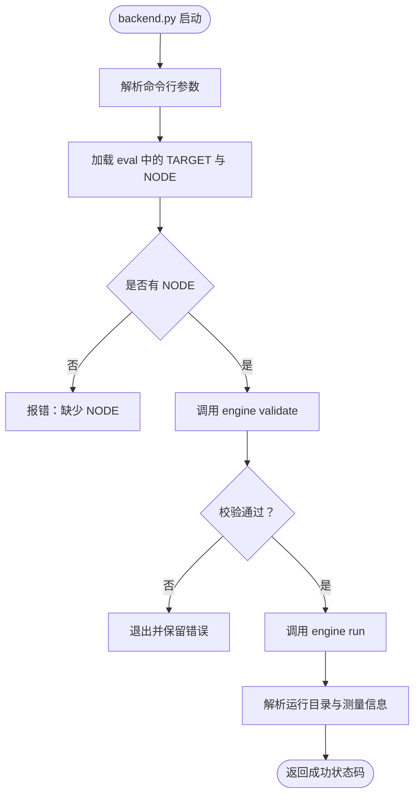

**图表来源**
- [frag/backend.py:1-125](file://frag/backend.py#L1-L125)
- [infra/target.py:1-81](file://infra/target.py#L1-L81)

**章节来源**
- [frag/backend.py:1-125](file://frag/backend.py#L1-L125)

### bootstrap.py：Blender 底座触发点

`bootstrap.py` 是 Blender 侧真正打开工程、定位对象和修改器、并执行用户 evaluate 的地方。它与节点边界检测的关键交互如下：

1. 加载并合并 TARGET。
2. 打开 blend 文件。
3. 定位对象、修改器，并确认它是几何节点修改器。
4. 如果存在 NODE，则调用 `targeting.validate_zones` 和 `targeting.resolve`。
5. 如果传入 `--phase=before` 或 `--phase=after`，则调用 `targeting.rewire` 临时重连拓扑。
6. 设置上下文变量，执行用户脚本的 `evaluate(ctx)`。
7. 写出 `status.json` 和 gates 产物。

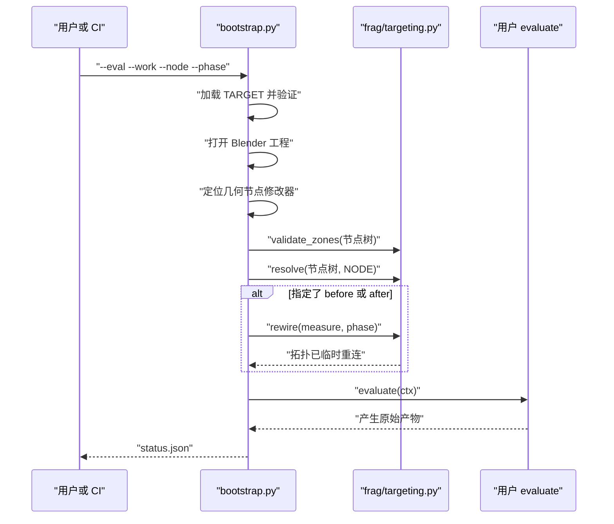

**图表来源**
- [bootstrap.py:61-114](file://bootstrap.py#L61-L114)
- [frag/targeting.py:1-136](file://frag/targeting.py#L1-L136)

**章节来源**
- [bootstrap.py:1-192](file://bootstrap.py#L1-L192)

### validate.py：Blender 侧验证入口

`frag/validate.py` 是 `engine validate` 子命令对应的 Blender 侧入口。它的行为很明确：

- 解析 eval 路径和可选的 `--measure-node`。
- 加载 TARGET 并校验必填字段。
- 打开工程，定位几何节点修改器。
- 调用 `targeting.validate_zones` 和 `targeting.resolve`。
- 向 stdout 输出 JSON 格式的验证结果，供 `backend.py` 解析。

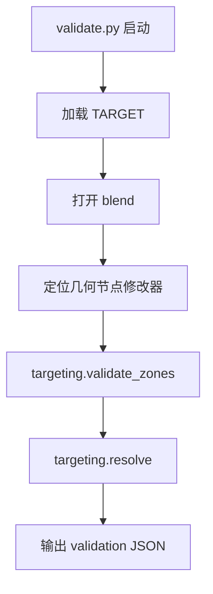

**图表来源**
- [frag/validate.py:1-66](file://frag/validate.py#L1-L66)

**章节来源**
- [frag/validate.py:1-66](file://frag/validate.py#L1-L66)

## 架构总览

整体调用链路可以分成三层：

1. **编排层**：`frag/backend.py` 和 `engine.py` 负责命令解析、前后阶段编排、缓存目录管理、diff_against 配置。
2. **Blender 运行时层**：`bootstrap.py`、`frag/validate.py`、`frag/targeting.py` 负责打开工程、定位修改器、校验节点拓扑、临时重连。
3. **产物层**：`cards/diff.py`、`registry.py` 将原始函数和边信息转换为人类可读的 `diff.json`，并把 `functions.jsonl` 作为 metrics 产物。

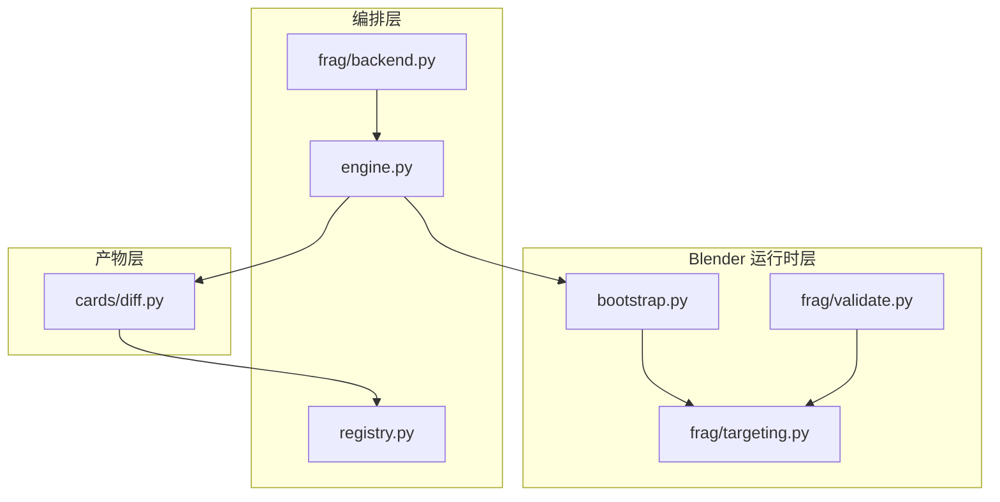

**图表来源**
- [frag/backend.py:1-125](file://frag/backend.py#L1-L125)
- [engine.py:224-273](file://engine.py#L224-L273)
- [bootstrap.py:61-114](file://bootstrap.py#L61-L114)
- [frag/validate.py:1-66](file://frag/validate.py#L1-L66)
- [frag/targeting.py:1-136](file://frag/targeting.py#L1-L136)
- [cards/diff.py:1-141](file://cards/diff.py#L1-L141)
- [registry.py:1-49](file://registry.py#L1-L49)

## 关键流程详解

### 一次完整节点边界检测的生命周期

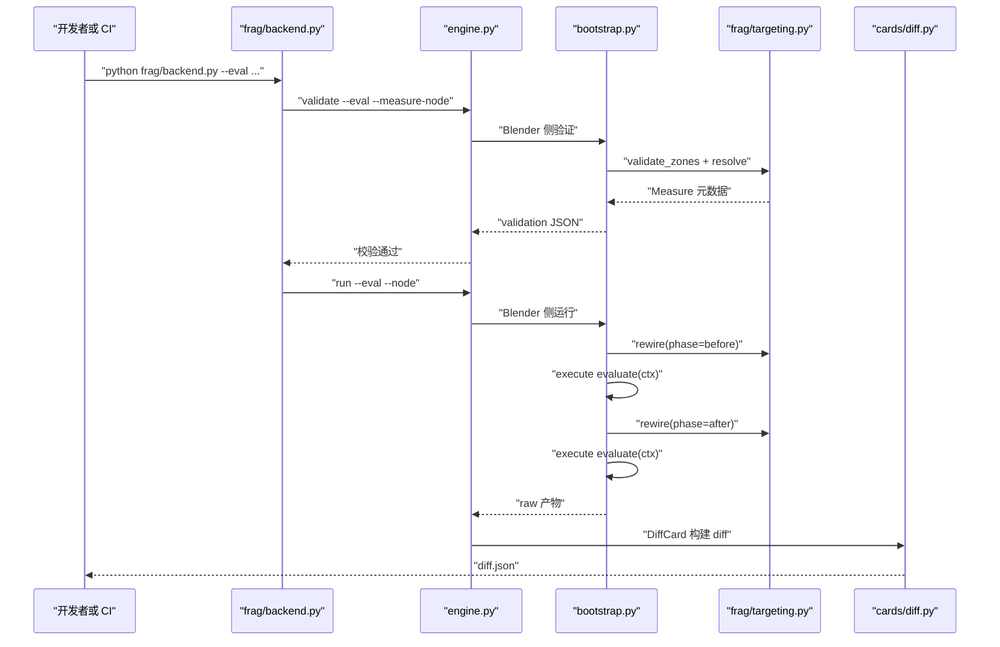

**图表来源**
- [frag/backend.py:45-125](file://frag/backend.py#L45-L125)
- [engine.py:224-273](file://engine.py#L224-L273)
- [bootstrap.py:61-114](file://bootstrap.py#L61-L114)
- [frag/targeting.py:104-136](file://frag/targeting.py#L104-L136)
- [cards/diff.py:60-141](file://cards/diff.py#L60-L141)

### before/after 重连逻辑

`rewire` 的逻辑非常直观：

- 先删除 Group Output 上已有的几何连线，避免污染。
- 如果是 after 阶段，将被测节点的几何输出直接连到 Group Output。
- 如果是 before 阶段，且被测节点有几何输入，则把该输入的源节点输出连到 Group Output。
- 最后标记节点树更新。

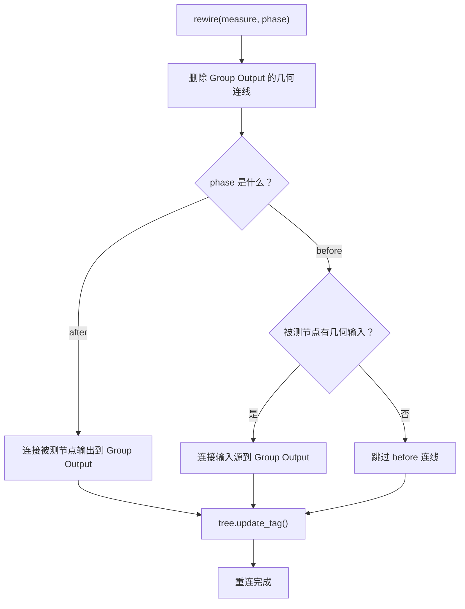

**图表来源**
- [frag/targeting.py:118-136](file://frag/targeting.py#L118-L136)

**章节来源**
- [frag/targeting.py:104-136](file://frag/targeting.py#L104-L136)

## NODE 字段语义与匹配规则

### NODE 的定义位置

NODE 写在用户的求值脚本中，例如 `eval/template.py`：

- 它是一个字符串字面量。
- 引擎通过 `infra/target.measure_node` 使用 AST 解析，不会执行脚本。
- 当存在 NODE 时，普通 `engine.py run` 会自动执行 before/after 流程并生成 `diff.json`。

### NODE 的匹配顺序

`find_measure_node` 的实现顺序是：

1. 精确匹配节点的 name、label、bl_idname。
2. 如果没有匹配结果，则对 spec 和目标字符串做规范化处理：去掉非字母数字字符，转为小写后再比较是否包含。
3. 如果仍没有匹配结果，抛出 `TargetError`。
4. 如果匹配到多个节点，也抛出 `TargetError`，列出冲突的节点名和类型。

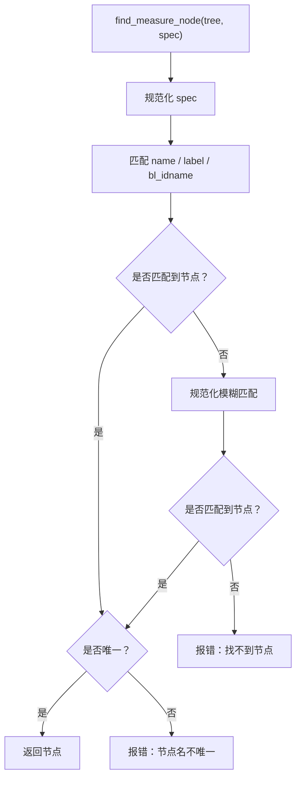

**图表来源**
- [frag/targeting.py:39-66](file://frag/targeting.py#L39-L66)

**章节来源**
- [frag/targeting.py:39-66](file://frag/targeting.py#L39-L66)
- [infra/target.py:34-59](file://infra/target.py#L34-L59)
- [eval/template.py:16-20](file://eval/template.py#L16-L20)

## 受限节点类型：Repeat、Foreach、Simulation

### 为什么禁止这些区域

`ZONE_TYPES` 包含三类受限节点：

- `GeometryNodeRepeatInput` / `GeometryNodeRepeatOutput`
- `GeometryNodeSimulationInput` / `GeometryNodeSimulationOutput`
- `GeometryNodeForeachGeometryElementInput` / `GeometryNodeForeachGeometryElementOutput`

这些节点通常表示循环、迭代或模拟语义。它们的存在会使“单次几何求值”的边界变得模糊，因为：

- 求值可能涉及多次迭代。
- 几何数据可能在循环内累积、分支或改变形状。
- before/after 的简单连线方式无法保证准确捕获“某个节点”的独立影响。
- 如果允许这类节点，CI 回归结果可能不稳定，难以解释。

因此，`validate_zones` 会在发现任何受限节点时直接拒绝，并列出具体节点名和类型，方便定位问题。

### 递归检查

`_collect_zones` 会递归进入 `GeometryNodeGroup` 的嵌套节点树，所以不仅当前层级受限节点会被拒绝，嵌套组中的受限节点也会被拒绝。

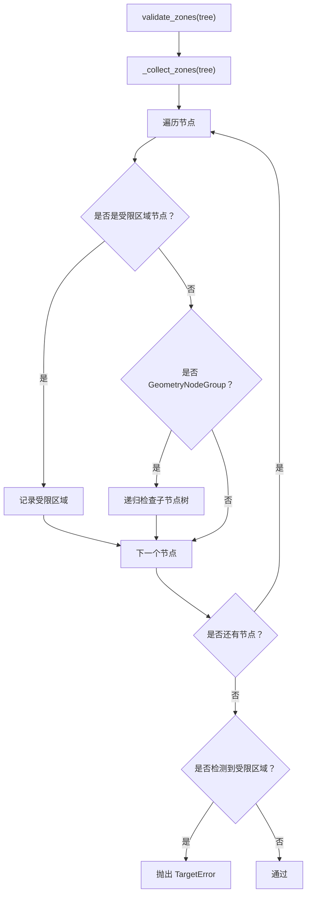

**图表来源**
- [frag/targeting.py:12-37](file://frag/targeting.py#L12-L37)

**章节来源**
- [frag/targeting.py:12-37](file://frag/targeting.py#L12-L37)

## before/after 区域校验失败原因与修复

### 常见错误分类

| 错误场景 | 触发位置 | 典型提示语义 | 修复方法 |
|---|---|---|---|
| eval 中没有 NODE，也没有 `--measure-node` | `infra/target.measure_node`、`frag/backend.py` | 缺少 NODE | 在求值脚本中添加 `NODE = "..."`，或通过命令行传入 `--measure-node` |
| 节点树里找不到节点 | `frag/targeting.find_measure_node` | 找不到节点 | 修正 NODE 值，使其匹配 name、label 或 bl_idname |
| 节点名不唯一 | `frag/targeting.find_measure_node` | 节点名不唯一 | 使用更具体的 name 或 label，避免歧义 |
| 节点没有正好一个几何输出 | `frag/targeting.resolve` | 需要正好一个几何输出 | 确保被测节点只有一个几何输出端口 |
| 节点有多个几何输入 | `frag/targeting.resolve` | v1 最多支持一个几何输入 | 简化被测节点，或只选一个几何输入；v1 设计如此 |
| Group Output 数量不为 1 | `frag/targeting._group_output_socket` | 需要且只能有一个 Group Output | 清理多余 Group Output 或确保只有一个几何输出端口 |
| Group Output 几何输出端口数量不为 1 | `frag/targeting._group_output_socket` | Group Output 需要且只能有一个几何输出 | 调整 Group Output 的几何输出端口数量 |
| 节点树包含 Repeat/Foreach/Simulation 区域 | `frag/targeting.validate_zones` | 暂不支持包含 ... 区域 | 移除或重构相关循环/迭代/模拟节点 |
| 修改器不是几何节点修改器 | `bootstrap.py`、`frag/validate.py` | modifier not found / is not geometry nodes | 确认 TARGET 中的 object、modifier、node_tree 正确 |
| node_tree 与实际修改器不一致 | `bootstrap.py` | node tree mismatch | 修正 TARGET 中的 `node_tree`，或删除该字段让系统使用默认组 |

### 定位建议

1. **先看 `bootstrap.py` 的修改器校验**：确认对象、修改器和节点树名称是否正确。
2. **再看 `frag/targeting.py` 的错误**：确认 NODE 是否能唯一匹配到被测节点。
3. **再看 Group Output 约束**：确认只有一个几何输出端口。
4. **最后看受限区域**：确认节点树及其嵌套组中没有 Repeat、Foreach、Simulation 输入输出节点。

**章节来源**
- [infra/target.py:1-81](file://infra/target.py#L1-L81)
- [frag/targeting.py:12-103](file://frag/targeting.py#L12-L103)
- [bootstrap.py:83-114](file://bootstrap.py#L83-L114)
- [frag/validate.py:35-66](file://frag/validate.py#L35-L66)

## 与 diff.json、functions.jsonl 的关系

### functions.jsonl

`registry.py` 将 `metrics` 产品映射为 `functions.jsonl`。该文件由 calls 闸门或其他指标卡片产出，记录被调用的函数集合。它是 diff 的前置依赖之一。

### diff.json

`cards/diff.py` 的 `DiffCard` 负责计算当前运行与前一次运行之间的差异：

- 需要 `raw:functions` 和 `raw:edges`。
- 如果提供了 `diff_against`，就加载前一次运行的 edge 数据。
- 如果当前运行没有直接的 edge.json，会使用 `symbols.symbolize` 从 `functions.bin` 和 `edges.bin` 重建。
- 输出包含 added/removed 的函数列表、边列表、计数、meta 信息等。
- meta 中包含 `measure_node`、`phase`、before/after 路径、时间戳等。

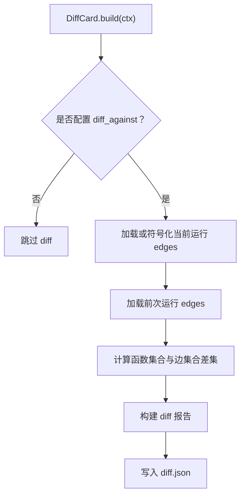

**图表来源**
- [cards/diff.py:1-141](file://cards/diff.py#L1-L141)
- [registry.py:17-49](file://registry.py#L17-L49)

**章节来源**
- [cards/diff.py:1-141](file://cards/diff.py#L1-L141)
- [registry.py:1-49](file://registry.py#L1-L49)

## 在 CI 中的回归判定作用

CI 通常关注的是：**同一个被测节点在不同版本或不同参数下，是否产生了新的函数调用或新的调用边。**

节点边界检测的作用在于：

1. **缩小观测范围**：通过 NODE 锁定单个几何节点，而不是对整个修改器黑盒求值。
2. **稳定 before/after 对比**：before 阶段透传输入几何，after 阶段透传被测节点输出，使 diff 更接近“该节点的影响”。
3. **让 diff.json 具备可解释性**：meta 中记录 measure_node 和 phase，便于判断新增函数来自 before 还是 after。
4. **与 functions.jsonl 配合**：diff 基于函数和边集合，而 functions.jsonl 提供函数符号信息，帮助把地址映射成可读函数名。

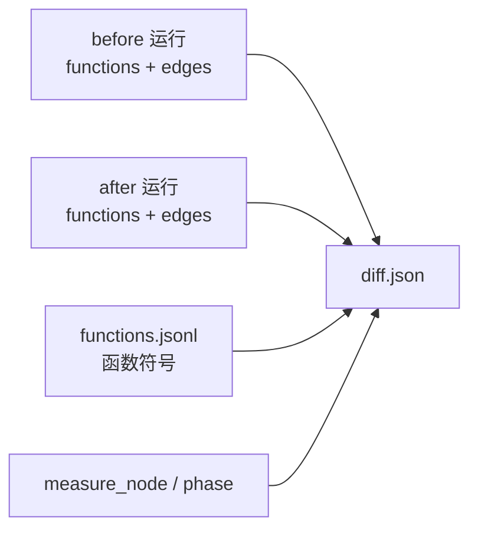

[本图为概念图，不直接对应具体源码结构]

## 性能与健壮性建议

### 性能建议

- **优先复用缓存**：`engine.py` 已经实现了按 hash8 组织的缓存目录、失败工作目录迁移、最近缓存保留策略。尽量保持 NODE 稳定，避免频繁改变被测节点导致缓存失效。
- **避免不必要的 before/after 切换**：如果只需要 after 结果，应减少重复运行次数。
- **控制评估参数数量**：模板脚本中对多个参数值循环求值会增加 CI 时间，可按需拆分测试用例。

### 健壮性建议

- **NODE 要稳定**：不要把 NODE 设为容易变动的 label，优先使用稳定的 name。
- **保持 Group Output 简洁**：只保留一个几何输出端口，避免多输出分支导致 diff 噪音。
- **避免复杂循环结构**：Repeat/Foreach/Simulation 会直接拒绝；即使能绕过，也可能让回归结果不可解释。
- **明确 phase**：CI 中应清楚区分 before 和 after 的差异，必要时分别维护基线。

[本节为通用建议，不直接分析具体源码行]

## 故障排查清单

| 步骤 | 检查项 | 期望结果 |
|---|---|---|
| 1 | eval 脚本中是否存在 TARGET | 包含 blend、object、modifier、param |
| 2 | eval 脚本中是否存在 NODE | 字符串形式，指向被测节点 |
| 3 | Blender 工程中是否存在同名对象和修改器 | 修改器类型为 NODES，节点组名称与 node_tree 一致 |
| 4 | NODE 是否能唯一匹配节点 | find_measure_node 不报错 |
| 5 | 被测节点是否只有一个几何输出 | resolve 能通过 |
| 6 | 被测节点是否最多一个几何输入 | v1 限制，否则 resolve 报错 |
| 7 | Group Output 是否只有一个几何输出端口 | _group_output_socket 通过 |
| 8 | 节点树是否包含 Repeat/Foreach/Simulation 区域 | validate_zones 通过 |
| 9 | before/after 是否都产生有效求值 | functions.bin 非空，edge_count 大于 0 |
| 10 | diff.json 是否包含 measure_node 和 phase | 可用于 CI 回归解释 |

**章节来源**
- [infra/target.py:1-81](file://infra/target.py#L1-L81)
- [frag/targeting.py:12-136](file://frag/targeting.py#L12-L136)
- [bootstrap.py:61-114](file://bootstrap.py#L61-L114)
- [engine.py:106-120](file://engine.py#L106-L120)
- [cards/diff.py:90-141](file://cards/diff.py#L90-L141)

## 结论

节点边界检测通过 `frag/targeting.py` 和 `frag/backend.py` 协作，把“对 Blender 几何节点求值的观测范围”从整个修改器收敛到单个节点。`targeting` 负责 Blender 侧的节点选择、区域校验和拓扑重连；`backend` 负责在非 Blender 进程中编排 validate 和 run，并把测量元数据传递给引擎。

该机制的核心价值是：

- 用 NODE 精确定位被测节点。
- 用 before/after 重连隔离节点影响。
- 用 diff.json 和 functions.jsonl 形成可解释的 CI 回归判定。
- 通过禁止 Repeat/Foreach/Simulation 区域，保证回归结果稳定、可归因。

对于使用者来说，最关键的是：正确填写 TARGET 和 NODE，保持 Group Output 简洁，避免受限节点类型，并在 CI 中明确 before 与 after 的基线和预期。