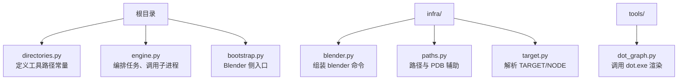
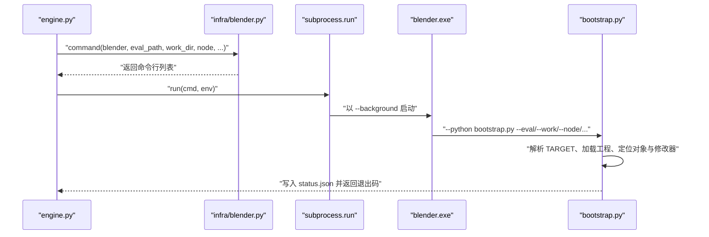
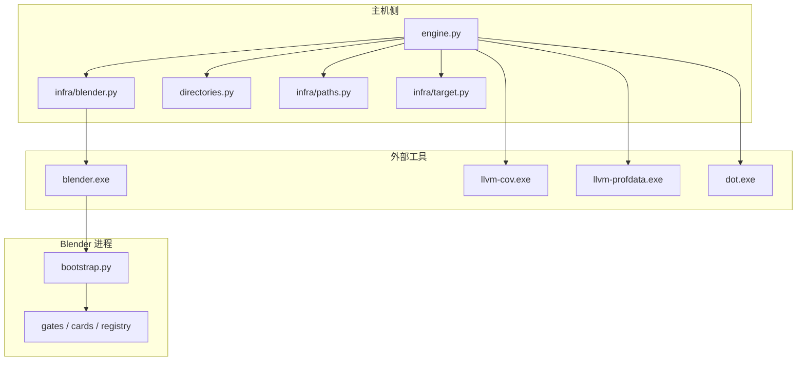
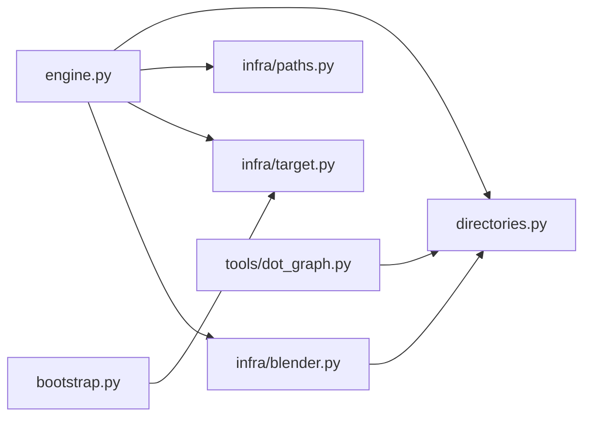

# 部署与运行环境

<cite>
**本文引用的文件**   
- [directories.py](file://directories.py)
- [infra/blender.py](file://infra/blender.py)
- [bootstrap.py](file://bootstrap.py)
- [engine.py](file://engine.py)
- [infra/paths.py](file://infra/paths.py)
- [infra/target.py](file://infra/target.py)
- [tools/dot_graph.py](file://tools/dot_graph.py)
</cite>

## 目录
1. [简介](#简介)
2. [项目结构](#项目结构)
3. [核心组件](#核心组件)
4. [架构总览](#架构总览)
5. [详细组件分析](#详细组件分析)
6. [依赖关系分析](#依赖关系分析)
7. [性能考虑](#性能考虑)
8. [故障排查指南](#故障排查指南)
9. [结论](#结论)
10. [附录：CI 建议](#附录ci-建议)

## 简介
CovTrace 是一个围绕 Blender 几何节点覆盖率采集、分析与可视化的工具链。它并非直接调用 Blender 业务逻辑，而是通过“主机侧编排 + Blender 进程执行”的方式工作：主机负责查找外部工具、组装命令行、管理缓存和输出；Blender 进程负责加载工程、定位对象与修改器、执行求值脚本并收集覆盖率数据。

本文聚焦部署与运行环境，说明：
- 必须使用带 `covtrace_*` 导出符号的自定义 Blender 构建。
- LLVM 工具链需要安装 `llvm-cov` 与 `llvm-profdata`。
- Graphviz 需要提供可执行的 `dot.exe`。
- Windows 环境需要 `dbghelp`。
- `directories.py` 中路径常量的配置方式。
- 如何通过环境变量或配置文件调整 Blender、LLVM、Graphviz 的位置。
- `infra/blender.py` 如何组装命令行、传递参数并处理非零退出码。
- CI 环境的缓存、版本锁定与隔离策略。
- 常见问题排查方法。

## 项目结构
从部署角度，关键文件分布如下：

**图表来源**
- [directories.py:1-25](file://directories.py#L1-L25)
- [engine.py:1-50](file://engine.py#L1-L50)
- [bootstrap.py:1-30](file://bootstrap.py#L1-L30)
- [infra/blender.py:1-39](file://infra/blender.py#L1-L39)
- [infra/paths.py:1-32](file://infra/paths.py#L1-L32)
- [infra/target.py:1-20](file://infra/target.py#L1-L20)
- [tools/dot_graph.py:1-20](file://tools/dot_graph.py#L1-L20)

**章节来源**
- [directories.py:1-25](file://directories.py#L1-L25)
- [engine.py:1-50](file://engine.py#L1-L50)
- [bootstrap.py:1-30](file://bootstrap.py#L1-L30)
- [infra/blender.py:1-39](file://infra/blender.py#L1-L39)
- [infra/paths.py:1-32](file://infra/paths.py#L1-L32)
- [infra/target.py:1-20](file://infra/target.py#L1-L20)
- [tools/dot_graph.py:1-20](file://tools/dot_graph.py#L1-L20)

## 核心组件
本节从“外部依赖 + 路径配置 + 子进程调用”三个维度梳理 CovTrace 的运行要求。

### 必须的外部依赖
| 依赖 | 用途 | 部署要求 |
|---|---|---|
| 自定义 Blender | 加载工程、执行求值、收集覆盖率 | 必须是编译时启用了覆盖追踪导出符号的版本；二进制文件名通常为 `blender.exe` |
| LLVM 工具链 | 生成与合并覆盖率数据 | 必须包含 `llvm-cov.exe` 与 `llvm-profdata.exe` |
| Graphviz | 将函数调用边图渲染为 PNG/SVG | 必须提供 `dot.exe` |
| Windows 调试支持 | 读取 PDB 符号信息 | 系统需安装 `dbghelp` 相关调试支持 |

其中：
- 自定义 Blender 是 CovTrace 能够采集几何节点覆盖率的基础，普通发布版 Blender 缺少必要的导出符号。
- LLVM 的 `llvm-cov` 用于处理覆盖率原始数据，`llvm-profdata` 用于合并或转换中间产物。
- Graphviz 的 `dot.exe` 由绘图工具调用，用于把 `edge.json` 等结构化数据转换为图形文件。
- `dbghelp` 是 Windows 平台下读取 PDB 符号文件的运行时依赖，缺失会导致符号解析失败。

**章节来源**
- [infra/paths.py:28-32](file://infra/paths.py#L28-L32)
- [tools/dot_graph.py:140-168](file://tools/dot_graph.py#L140-L168)

### 路径常量与可配置位置
`directories.py` 集中声明了所有固定路径常量，包括：
- Blender 二进制目录
- LLVM 二进制目录
- Graphviz 二进制目录
- Blender 源码目录
- 输出目录、缓存目录、frag 目录
- 具体可执行文件路径：`blender.exe`、`llvm-cov.exe`、`llvm-profdata.exe`、`dot.exe`
- 内部脚本路径：`engine.py`、`bootstrap.py`、`validate.py`

当前实现使用硬编码 Windows 绝对路径。若要在不同机器上复用，应优先通过以下方式调整：
1. 直接修改 `directories.py` 中的路径常量。
2. 在导入 `directories` 之前设置相关环境变量（例如 `BLENDER_BIN_DIR`、`LLVM_BIN_DIR`、`GRAPHVIZ_BIN_DIR`），并在 `directories.py` 中读取环境变量后再拼接最终路径。
3. 对引擎启动层增加配置文件加载逻辑，把 `out_dir`、`cache_dir`、`blender_exe`、`llvm_cov_exe`、`dot_exe` 等键暴露出来，供 CI 或本地用户覆盖默认值。

注意：当前代码没有显式读取这些环境变量，因此仅修改环境变量不会生效；需要配合代码改动才能生效。

**章节来源**
- [directories.py:1-25](file://directories.py#L1-L25)

### Blender 子进程调用流程
`infra/blender.py` 负责组装 Blender 命令行，并把评估脚本、工作目录、节点标识以及可选参数传递给 Bootstrap。

**图表来源**
- [infra/blender.py:1-39](file://infra/blender.py#L1-L39)
- [bootstrap.py:1-40](file://bootstrap.py#L1-L40)
- [bootstrap.py:120-192](file://bootstrap.py#L120-L192)

#### 命令行组装规则
- 始终传入 `--background` 和 `--python bootstrap.py`。
- 必传参数：`--eval`、`--work`、`--node`。
- 可选参数：`--gates`、`--blend`、`--obj`、`--mod`、`--param`、`--phase`、`--measure-node`。
- 只有当对应参数有值时才追加到命令列表中，避免空参数污染执行环境。

#### 错误处理
`infra/blender.py` 的 `run` 函数使用 `subprocess.run` 执行命令，但没有立即检查返回码。真正决定是否失败的是：
- Blender 进程本身是否返回非零退出码。
- Bootstrap 是否抛出异常。
- 上层引擎是否根据状态文件或退出码判断成功与否。

**章节来源**
- [infra/blender.py:1-39](file://infra/blender.py#L1-L39)
- [bootstrap.py:1-40](file://bootstrap.py#L1-L40)
- [bootstrap.py:120-192](file://bootstrap.py#L120-L192)

## 架构总览
下图展示 CovTrace 的主机编排层、Blender 执行层与外部工具的交互关系。

**图表来源**
- [engine.py:1-50](file://engine.py#L1-L50)
- [infra/blender.py:1-39](file://infra/blender.py#L1-L39)
- [directories.py:1-25](file://directories.py#L1-L25)
- [infra/paths.py:1-32](file://infra/paths.py#L1-L32)
- [infra/target.py:1-20](file://infra/target.py#L1-L20)
- [bootstrap.py:1-30](file://bootstrap.py#L1-L30)

## 详细组件分析

### directories.py：路径常量配置
该文件定义了项目根目录、工具目录、输出目录、缓存目录、frag 目录，以及各工具的可执行文件路径。其特点是：
- 所有路径都基于 `ROOT` 或固定绝对路径构造。
- `OUT_DIR`、`CACHE_DIR`、`FRAG_DIR` 适合在 CI 中替换为临时目录。
- `BLENDER_EXE`、`LLVM_COV_EXE`、`LLVM_PROFDATA_EXE`、`DOT_EXE` 是后续子进程调用的直接入口。

建议的扩展方式：
- 在文件开头读取环境变量，如果存在则覆盖默认目录。
- 对每个工具路径提供“优先使用环境变量、其次使用常量”的分支。
- 保留当前相对路径风格，便于跨仓库迁移。

**章节来源**
- [directories.py:1-25](file://directories.py#L1-L25)

### infra/blender.py：Blender 命令行组装与执行
该模块承担两个职责：
1. 将高层参数映射为 Blender 命令行。
2. 通过 `subprocess.run` 启动 Blender。

关键行为：
- `command()` 返回字符串列表形式的命令，不包含 shell 解释器。
- `run()` 打印完整命令，并以 UTF-8 文本模式读取输出。
- 未显式检查 `returncode`，因此上层必须结合返回值或状态文件判断执行结果。

风险点：
- 如果 `blender.exe` 不存在或无法启动，`subprocess.run` 会抛出异常。
- 如果 Blender 内部出错但返回码为零，仅靠退出码可能误判成功，应同时检查 `status.json`。

**章节来源**
- [infra/blender.py:1-39](file://infra/blender.py#L1-L39)

### bootstrap.py：Blender 侧执行入口
Bootstrap 的职责是：
- 解析命令行参数。
- 加载评估脚本中的 `TARGET` 与可选 `NODE`。
- 打开 Blender 工程、定位对象、修改器与几何节点树。
- 根据闸门配置执行求值，并写入 `status.json`。
- 捕获异常后仍写入失败状态，便于上层诊断。

典型失败场景：
- 找不到目标对象。
- 修改器不是几何节点修改器。
- 节点树名称不匹配。
- 求值脚本未定义 `evaluate(ctx)`。
- 闸门缺少必要导出符号。

**章节来源**
- [bootstrap.py:1-40](file://bootstrap.py#L1-L40)
- [bootstrap.py:120-192](file://bootstrap.py#L120-L192)

### infra/target.py：TARGET 解析
该模块在不执行评估脚本的前提下，通过 AST 解析出 `TARGET` 字典和可选 `NODE`。这避免了主机侧意外执行 Blender 相关代码。

校验规则包括：
- `TARGET` 必须是字面量字典。
- 必需字段：`blend`、`object`、`modifier`、`param`。
- `blend` 对应的工程文件必须存在。
- `node_tree` 如果是可选字段，必须是字符串。

**章节来源**
- [infra/target.py:1-81](file://infra/target.py#L1-L81)

### tools/dot_graph.py：Graphviz 调用
该脚本负责把边缘数据渲染成 PNG 或 SVG。它：
- 通过 `argparse` 接受哈希或显式 `edge_json` 路径。
- 默认使用 `directories.DOT_EXE`。
- 如果 `dot.exe` 不存在，返回非零退出码并提示错误。
- 使用 `subprocess.run([...], check=True)` 执行渲染命令。

这说明 Graphviz 的 `dot.exe` 是可选但必要的可视化依赖：如果不渲染图片，CovTrace 主流程不一定直接依赖它；但绘图工具会强依赖它。

**章节来源**
- [tools/dot_graph.py:1-20](file://tools/dot_graph.py#L1-L20)
- [tools/dot_graph.py:140-168](file://tools/dot_graph.py#L140-L168)

### infra/paths.py：PDB 与路径辅助
该模块提供：
- 路径规范化。
- 安全目录名生成。
- 文件指纹计算。
- PDB 路径推导：给定 Blender 路径，返回同名的 `.pdb` 文件。

PDB 路径推导意味着符号文件应与 Blender 二进制位于同一目录或可通过约定找到。如果 PDB 缺失，符号解析可能失败。

**章节来源**
- [infra/paths.py:1-32](file://infra/paths.py#L1-L32)

## 依赖关系分析
下图按“模块依赖”视角展示关键耦合关系。

**图表来源**
- [engine.py:1-50](file://engine.py#L1-L50)
- [directories.py:1-25](file://directories.py#L1-L25)
- [infra/paths.py:1-32](file://infra/paths.py#L1-L32)
- [infra/target.py:1-20](file://infra/target.py#L1-L20)
- [infra/blender.py:1-39](file://infra/blender.py#L1-L39)
- [bootstrap.py:1-30](file://bootstrap.py#L1-L30)
- [tools/dot_graph.py:1-20](file://tools/dot_graph.py#L1-L20)

**章节来源**
- [engine.py:1-50](file://engine.py#L1-L50)
- [directories.py:1-25](file://directories.py#L1-L25)
- [infra/blender.py:1-39](file://infra/blender.py#L1-L39)
- [bootstrap.py:1-30](file://bootstrap.py#L1-L30)
- [tools/dot_graph.py:1-20](file://tools/dot_graph.py#L1-L20)

## 性能考虑
- Blender 进程启动成本较高，应避免重复启动相同任务。CovTrace 通过 `out` 和 `cache` 目录缓存结果，减少重复求值。
- LLVM 覆盖率处理涉及磁盘 I/O 与符号解析，建议将 `out` 放在本地高速盘，而非网络驱动器。
- Graphviz 渲染大图时可能消耗较多内存，建议在单独环境中运行 `tools/dot_graph.py`，避免与 CI 主任务争抢资源。
- 并行卡片执行由引擎层调度，但覆盖率卡片通常依赖其他卡片产出，因此实际并行度有限。

[本节为通用性能建议，不直接分析特定文件]

## 故障排查指南

### 找不到 blender.exe
**现象**  
启动 Blender 时报找不到可执行文件，或直接抛出子进程启动异常。

**原因**  
- `directories.py` 中的 `BLENDER_BIN_DIR` 指向不存在的路径。
- 自定义 Blender 构建未放置到预期目录。
- 环境变量未更新，但 `directories.py` 仍使用旧路径。

**排查步骤**
1. 确认 `directories.py` 中的 `BLENDER_BIN_DIR` 是否存在。
2. 确认该目录下存在 `blender.exe`。
3. 如果改用环境变量，确保已修改 `directories.py` 使其读取环境变量。
4. 在 CI 中确认构建阶段已将自定义 Blender 复制到指定路径。

**章节来源**
- [directories.py:1-25](file://directories.py#L1-L25)
- [infra/blender.py:1-39](file://infra/blender.py#L1-L39)

### llvm-cov 不可用
**现象**  
覆盖率处理阶段报错，提示找不到 `llvm-cov.exe`。

**原因**  
- `LLVM_BIN_DIR` 未指向包含 `llvm-cov.exe` 的目录。
- LLVM 工具链不完整，缺少 `llvm-cov.exe`。
- PATH 未正确配置，而代码又依赖固定路径。

**排查步骤**
1. 检查 `directories.py` 中的 `LLVM_BIN_DIR`。
2. 确认该目录存在 `llvm-cov.exe` 与 `llvm-profdata.exe`。
3. 在命令行手动执行 `llvm-cov --version` 验证工具可用。
4. 如使用多版本 LLVM，确保 CI 安装了预期版本。

**章节来源**
- [directories.py:1-25](file://directories.py#L1-L25)

### dot 未安装
**现象**  
运行 `tools/dot_graph.py` 时报 `dot.exe not found`。

**原因**  
- `GRAPHVIZ_BIN_DIR` 配置错误。
- Graphviz 未安装或未将 `dot.exe` 放入预期目录。
- 仅修改 PATH 不够，因为工具默认使用 `directories.DOT_EXE`。

**排查步骤**
1. 检查 `directories.py` 中的 `GRAPHVIZ_BIN_DIR`。
2. 确认该目录存在 `dot.exe`。
3. 也可通过 `tools/dot_graph.py` 的 `--dot` 参数指定可执行文件路径。
4. 如果只关心 JSON 产品而不渲染图片，可跳过 Graphviz。

**章节来源**
- [directories.py:1-25](file://directories.py#L1-L25)
- [tools/dot_graph.py:140-168](file://tools/dot_graph.py#L140-L168)

### PDB 符号缺失
**现象**  
覆盖率或符号解析阶段无法找到函数符号，或日志中出现与 PDB 相关的错误。

**原因**  
- Blender 构建时未生成 PDB。
- PDB 文件未与 `blender.exe` 放在同一目录或符合 `infra/paths.pdb_for` 的预期命名。
- Windows 调试支持不完整，导致 `dbghelp` 无法加载符号。

**排查步骤**
1. 确认自定义 Blender 构建启用了 PDB 生成。
2. 确认 `blender.exe` 同级目录存在同名 `.pdb`。
3. 在 Windows 上确认系统具备 `dbghelp` 相关调试能力。
4. 使用 Visual Studio 或 Windows 调试工具验证 PDB 可读。

**章节来源**
- [infra/paths.py:28-32](file://infra/paths.py#L28-L32)

### Blender 内部求值失败
**现象**  
Blender 进程能启动，但最终结果为失败，`status.json` 中记录异常。

**原因**  
- 找不到目标对象或修改器。
- 修改器不是几何节点修改器。
- 节点树名称与 `TARGET` 不一致。
- 求值脚本未定义 `evaluate(ctx)`。
- 闸门缺少必要导出符号。

**排查步骤**
1. 查看 `out/<node>/<hash>/status.json` 中的错误信息。
2. 确认评估脚本中的 `TARGET` 与实际 Blender 工程一致。
3. 确认 Blender 工程中存在对应对象、修改器和几何节点树。
4. 确认闸门模块导出了所需符号。

**章节来源**
- [bootstrap.py:120-192](file://bootstrap.py#L120-L192)
- [infra/target.py:1-81](file://infra/target.py#L1-L81)

## 结论
CovTrace 的运行环境由三部分组成：
1. **自定义 Blender**：必须包含覆盖追踪所需的导出符号。
2. **LLVM 工具链**：必须提供 `llvm-cov.exe` 与 `llvm-profdata.exe`。
3. **Graphviz 与 Windows 调试支持**：`dot.exe` 用于绘图，`dbghelp` 用于符号解析。

当前实现通过 `directories.py` 集中管理路径常量，便于统一配置。若要提升可移植性，应在该文件中引入环境变量或配置文件覆盖机制，使不同机器和 CI 环境都能灵活指定工具路径。`infra/blender.py` 负责把高层参数转为 Blender 命令行，并由 `bootstrap.py` 在 Blender 进程中完成工程加载与求值。上层引擎应根据状态文件和退出码判断执行结果，而不是仅依赖子进程返回码。

[本节为总结性内容，不直接分析特定文件]

## 附录：CI 建议

### 缓存 LLVM 工具链
- 将 `LLVM_BIN_DIR` 所指的目录加入 CI 缓存键，避免每次重新下载。
- 缓存键应包含 LLVM 版本号，防止新旧工具链混用。
- 首次构建完成后，缓存 `llvm-cov.exe` 与 `llvm-profdata.exe` 所在目录。

### 锁定 Blender 版本
- 不要使用最新发布的 Blender，应锁定到经过验证的版本。
- 自定义构建也应按版本标签或提交哈希缓存。
- 在 `directories.py` 或 CI 配置中明确记录 Blender 版本，避免隐式升级。

### 隔离 out 目录
- 每个任务使用独立 `out` 目录，避免多个作业互相覆盖结果。
- `cache` 目录可用于共享只读中间产物，但写操作应限制在单个任务内。
- 清理策略应保留最近若干次成功缓存，并归档失败任务的 `failed-*` 目录。

### 避免共享缓存冲突
- 不要共享正在写入的 `out` 目录。
- 如果共享 `cache`，应确保写入路径稳定，且并发访问不会竞争同一个哈希目录。
- 对于 Graphviz 渲染，建议在单独任务中执行，避免与覆盖率处理争抢资源。

### 推荐 CI 任务划分
1. **构建阶段**：构建自定义 Blender、准备 LLVM、准备 Graphviz。
2. **采集阶段**：运行 CovTrace，生成 `out` 与 `cache`。
3. **分析阶段**：读取 `out` 中的 JSON 产品，进行差异对比。
4. **可视化阶段**：调用 `tools/dot_graph.py` 渲染 PNG/SVG。
5. **归档阶段**：上传 `out`、`cache`、失败任务产物。

[本节为通用 CI 实践建议，不直接分析特定文件]