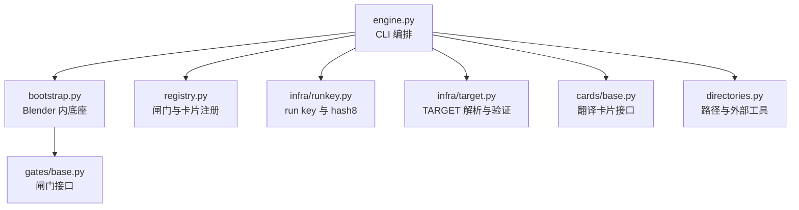
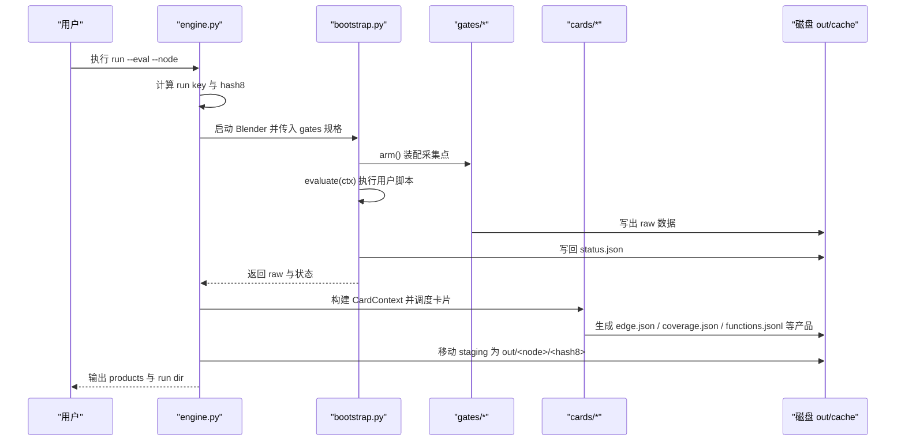
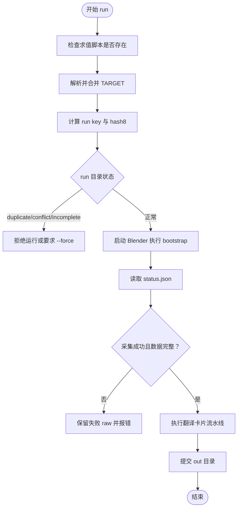
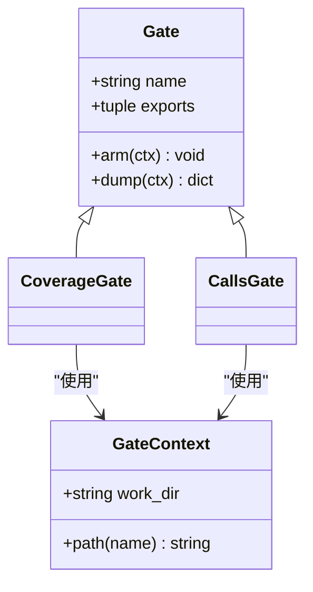
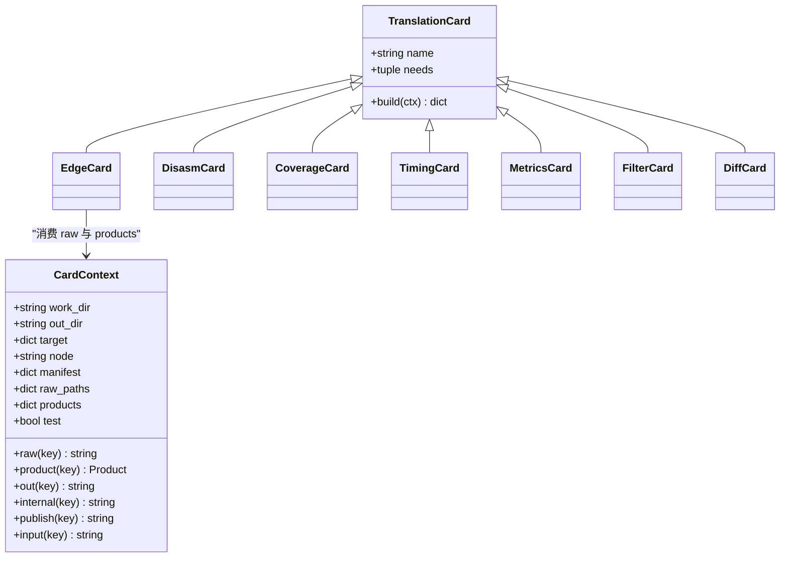
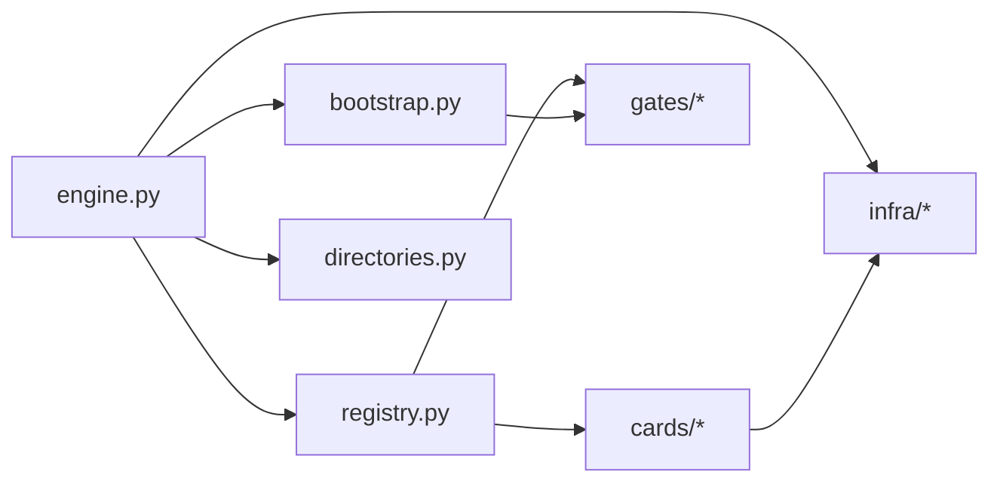

# 项目概述

<cite>
**本文引用的文件**   
- [engine.py](file://engine.py)
- [bootstrap.py](file://bootstrap.py)
- [registry.py](file://registry.py)
- [directories.py](file://directories.py)
- [infra/runkey.py](file://infra/runkey.py)
- [infra/target.py](file://infra/target.py)
- [cards/base.py](file://cards/base.py)
- [gates/base.py](file://gates/base.py)
</cite>

## 目录
1. [引言](#引言)
2. [项目结构](#项目结构)
3. [核心组件](#核心组件)
4. [架构总览](#架构总览)
5. [详细组件分析](#详细组件分析)
6. [依赖关系分析](#依赖关系分析)
7. [性能与产物特性](#性能与产物特性)
8. [故障排查指南](#故障排查指南)
9. [结论](#结论)

## 引言
CovTrace 是一个面向 Blender Geometry Nodes 修改器的专用工程工具链，而不是普通桌面应用。它的主要目标是：在 Blender 中加载指定的几何节点修改器、执行用户提供的求值脚本、通过“闸门”采集函数调用边与时序数据、基于 LLVM profraw 生成源码行覆盖率，并以 `run key + hash8` 组织输出产物。最终产出以 `out/<node>/<hash8>/` 下的 JSON/JSONL 文件为主，例如 `edge.json`、`coverage.json`、`functions.jsonl`、`filter.json`、`diff.json` 等。

适用人群包括：
- Blender 开发者：用于对比不同版本或不同参数下几何节点修改器的行为差异。
- CI 集成者：用于自动化回归测试和覆盖率审计。
- 扩展开发者：用于理解 Geometry Nodes 的底层调用路径与覆盖情况。

核心术语如下：
- **Gate（闸门）**：运行在 Blender 进程内的采集钩子，负责在求值前后注入探针并写出原始数据。
- **TranslationCard（翻译卡片）**：运行在宿主 Python 进程中的数据处理步骤，把 raw 数据转成最终的 JSON/JSONL 产品。
- **raw**：闸门产出的中间原始数据，例如函数列表、边缘计数、profraw 路径等。
- **product**：卡片注册的可对外发布的产物名称，如 `edge`、`coverage`、`metrics` 等。
- **run key**：由求值脚本内容、目标节点名、Blender 可执行文件、符号文件、TARGET 配置和执行选项共同计算出的完整标识。
- **hash8**：run key 的前八位十六进制字符，用作 `out` 目录下的短标识。
- **before / after**：当检测到 eval 脚本中包含 NODE 时，引擎自动先执行一次 before 求值，再执行一次 after 求值，从而自动生成 diff。

## 项目结构
仓库按职责划分为若干模块：
- `engine.py`：CLI 编排主程序，提供 `run`、`translate`、`validate` 三个命令。
- `bootstrap.py`：在 Blender 内运行的底座脚本，打开工程、装配闸门、执行求值、写入 status 与 raw。
- `cards/*`：翻译卡片集合，每个卡片实现从 raw 到 product 的转换。
- `gates/*`：闸门实现，包含调用计数、覆盖率采集等。
- `infra/*`：基础设施层，负责 run key、TARGET 解析、目标合并与验证、路径与外部工具定位。
- `frag/*`：Blender 侧片段工具，用于测量区域校验与重连。
- `tools/*`：辅助可视化工具。
- `directories.py`：集中定义根目录、Blender/LLVM/Graphviz 路径与外部可执行文件位置。
- `registry.py`：注册所有闸门、卡片与产品映射。

**图表来源**
- [engine.py:201-562](file://engine.py#L201-L562)
- [bootstrap.py:1-192](file://bootstrap.py#L1-L192)
- [registry.py:1-49](file://registry.py#L1-L49)
- [infra/runkey.py:1-44](file://infra/runkey.py#L1-L44)
- [infra/target.py:1-81](file://infra/target.py#L1-L81)
- [cards/base.py:1-63](file://cards/base.py#L1-L63)
- [gates/base.py:1-38](file://gates/base.py#L1-L38)
- [directories.py:1-25](file://directories.py#L1-L25)

**章节来源**
- [engine.py:1-200](file://engine.py#L1-L200)
- [engine.py:201-562](file://engine.py#L201-L562)
- [bootstrap.py:1-192](file://bootstrap.py#L1-L192)
- [registry.py:1-49](file://registry.py#L1-L49)
- [directories.py:1-25](file://directories.py#L1-L25)

## 核心组件
CovTrace 的核心分工是“宿主引擎 + Blender 底座 + 闸门 + 翻译卡片”。

- **宿主引擎 engine.py**
  - 解析 CLI 参数，决定执行 `run`、`translate` 或 `validate`。
  - 计算 `run key` 和 `hash8`，确定 `out/<node>/<hash8>` 和 `cache/<node>/<hash8>`。
  - 启动 Blender 执行 bootstrap，收集 status 与 raw。
  - 构建 `CardContext`，按注册顺序调度翻译卡片。
  - 将内部中间产物与公开产品分离，并把结果落盘。

- **Blender 底座 bootstrap.py**
  - 解析求值脚本中的 TARGET，加载 .blend 工程。
  - 找到对象、几何节点修改器及其 node_group。
  - 根据 `--phase=before|after` 与 `--measure-node` 对测量区域进行重连。
  - 动态导入闸门类，依次调用 `arm`。
  - 执行用户脚本中的 `evaluate(ctx)`，并在 finally 中按逆序 dump 闸门数据。
  - 写回 `status.json` 与 raw 路径汇总。

- **闸门 gates/**
  - 基类 Gate 定义 `name`、`exports`、`arm`、`dump`。
  - 通过 Windows API 检查导出符号是否可用。
  - 默认注册 `CoverageGate` 与 `CallsGate`，分别采集覆盖率与函数调用边。

- **翻译卡片 cards/**
  - 基类 TranslationCard 定义 `name`、`needs`、`build`。
  - CardContext 提供 raw 读取、产品路径计算、发布路径控制。
  - 默认注册 edge、disasm、coverage、timing、metrics、filter、diff 等卡片。

- **基础设施 infra/**
  - `runkey.py` 用 sha256 组合 eval 内容、node、blender、pdb、target、options，得到 run key；`short` 取前八位作为 hash8。
  - `target.py` 使用 AST 安全解析 eval 中的 TARGET 与可选 NODE，不做运行时副作用。
  - `paths`、`manifest`、`blender` 等模块被 engine 和 bootstrap 复用。

**章节来源**
- [engine.py:201-562](file://engine.py#L201-L562)
- [bootstrap.py:1-192](file://bootstrap.py#L1-L192)
- [gates/base.py:1-38](file://gates/base.py#L1-L38)
- [cards/base.py:1-63](file://cards/base.py#L1-L63)
- [infra/runkey.py:1-44](file://infra/runkey.py#L1-L44)
- [infra/target.py:1-81](file://infra/target.py#L1-L81)
- [registry.py:1-49](file://registry.py#L1-L49)

## 架构总览
CovTrace 的整体流程可以理解为“CLI 驱动 → Blender 求值 → 闸门采集 → 卡片翻译 → 产物落盘”。

**图表来源**
- [engine.py:201-562](file://engine.py#L201-L562)
- [bootstrap.py:1-192](file://bootstrap.py#L1-L192)
- [registry.py:1-49](file://registry.py#L1-L49)
- [cards/base.py:1-63](file://cards/base.py#L1-L63)

## 详细组件分析

### 执行命令与自动 diff
engine.py 的 `run` 命令支持三种模式：
- 常规模式：执行一次求值，生成 raw 并翻译卡片。
- 自动 diff 模式：如果 eval 脚本中存在 NODE，则先执行 `before`，再执行 `after`，并尝试比较差异。
- dry-run 模式：只检查路径、重复状态与外部工具可用性，不启动 Blender。

关键处理逻辑包括：
- 校验 eval 脚本是否存在。
- 解析 TARGET 并合并命令行覆盖项。
- 计算 measure_node 规格。
- 生成 run key、hash8、run_dir、cache_dir。
- 检测 duplicate、conflict、incomplete 状态。
- 启动 Blender，等待 status.json。
- 校验 calls 与 coverage 的完整性。
- 执行卡片流水线。
- 清理或保留 cache，最终提交 run 目录。

**图表来源**
- [engine.py:201-562](file://engine.py#L201-L562)

**章节来源**
- [engine.py:201-562](file://engine.py#L201-L562)

### Blender 底座与闸门
bootstrap.py 的职责是在 Blender 进程内完成真实求值与数据采集：
- 解析 CLI 参数，尤其是 `--eval`、`--work`、`--node`、`--phase`、`--measure-node`。
- 加载 target 文件，打开 .blend，定位对象、修改器与 node_group。
- 根据测量节点规范校验并重连边界。
- 动态导入闸门类，调用 `missing_exports` 检查符号。
- 执行 `evaluate(ctx)`，并通过 `ctx.set_value` 修改参数、触发 `view_layer.update()`。
- 在 finally 中按逆序 dump 所有闸门，汇总 raw，写回 status.json。

**图表来源**
- [gates/base.py:1-38](file://gates/base.py#L1-L38)

**章节来源**
- [bootstrap.py:1-192](file://bootstrap.py#L1-L192)
- [gates/base.py:1-38](file://gates/base.py#L1-L38)

### 翻译卡片流水线
cards/base.py 定义了统一的卡片接口与上下文：
- `CardContext` 持有 work_dir、out_dir、target、node、manifest、raw_paths、products、options、test。
- `raw(key)` 读取已注册的原始数据路径。
- `out(key)` 与 `internal(key)` 分别生成公开路径与内部中间路径。
- `publish(key)` 根据 product 的 internal 标志决定是否放入 `_internal`。
- `TranslationCard` 抽象出 `name`、`needs`、`build`。

registry.py 把所有卡片与产品映射集中注册，使 engine.py 能按固定顺序执行：
- edge：生成边信息。
- disasm：反汇编中间产物，通常标记为 internal。
- coverage：生成覆盖率。
- timing：时序中间产物，通常标记为 internal。
- metrics：函数级指标，通常输出 JSONL。
- filter：过滤后的产物。
- diff：前后 diff。

**图表来源**
- [cards/base.py:1-63](file://cards/base.py#L1-L63)
- [registry.py:1-49](file://registry.py#L1-L49)

**章节来源**
- [cards/base.py:1-63](file://cards/base.py#L1-L63)
- [registry.py:1-49](file://registry.py#L1-L49)

### run key 与输出组织
infra/runkey.py 计算 run key 的方式非常明确：
- 版本号常量。
- 对 eval 脚本内容做分块 sha256。
- 追加 node。
- 追加 blender 与 pdb 的文件指纹。
- 追加排序后的 target JSON。
- 追加排序后的 options JSON。
- short 函数直接截取前八位作为 hash8。

engine.py 据此决定：
- `out_root = out`
- `run_dir = out/<node>/<hash8>`
- `cache_dir = cache/<node>/<hash8>`
- 工作临时目录为 `cache/<node>/<hash8>.tmp`
- 翻译临时目录为 `out/<node>/.<hash8>.tmp`

这意味着同一组输入会稳定落到同一个 hash8 目录，避免 CI 或本地重复执行产生不可预期覆盖。

**章节来源**
- [infra/runkey.py:1-44](file://infra/runkey.py#L1-L44)
- [engine.py:201-562](file://engine.py#L201-L562)

### TARGET 解析与验证
infra/target.py 不执行求值脚本，而是用 AST 解析：
- 查找顶层赋值 `TARGET = {...}`。
- 要求 blend、object、modifier、param 四个字段存在。
- 支持可选 node_tree。
- 提供 merge 方法合并命令行覆盖项。
- 提供 validate 方法校验工程路径与类型。
- 支持可选 NODE 字符串，用于自动 diff。

这保证了主机端不会因 eval 脚本副作用而意外改变环境。

**章节来源**
- [infra/target.py:1-81](file://infra/target.py#L1-L81)

## 依赖关系分析
CovTrace 的依赖关系呈现清晰的层次：
- 最外层是 CLI 引擎 engine.py。
- 中间层是 Blender 底座 bootstrap.py、闸门 gates/*、卡片 cards/*。
- 最内层是 infra/* 与 directories.py。

**图表来源**
- [engine.py:1-200](file://engine.py#L1-L200)
- [bootstrap.py:1-192](file://bootstrap.py#L1-L192)
- [registry.py:1-49](file://registry.py#L1-L49)
- [directories.py:1-25](file://directories.py#L1-L25)

**章节来源**
- [engine.py:1-200](file://engine.py#L1-L200)
- [registry.py:1-49](file://registry.py#L1-L49)

## 性能与产物特性
- 这是专用工程工具，不是普通应用：主要交互入口是 `python engine.py run ...`，典型产出是 `out/<node>/<hash8>/` 下的 JSON 与 JSONL。
- 默认产物包括：
  - `edge.json`：几何节点边信息。
  - `coverage.json`：覆盖率结果。
  - `functions.jsonl`：函数级指标。
  - `filter.json`：过滤后产物。
  - `diff.json`：before/after 差异。
- 内部中间产物如 `disasm.json`、`timing.json` 通常放在 `_internal`，除非启用 `--test`。
- 如果启用 `--no-raw`，引擎会在卡片成功后删除原始 cache，只保留精简后的 manifest 与产品。
- 如果启用 `--keep-all`，覆盖率不过滤 source/ 与 intern/ 路径，适合需要全量覆盖数据的场景。
- cache 目录默认保留最近 N 个节点缓存，可通过 `--keep-cache` 调整。

**章节来源**
- [engine.py:1-200](file://engine.py#L1-L200)
- [engine.py:201-562](file://engine.py#L201-L562)
- [directories.py:1-25](file://directories.py#L1-L25)
- [registry.py:1-49](file://registry.py#L1-L49)

## 故障排查指南
常见错误与对应处理：
- **找不到求值脚本**：engine.py 会直接报错，确认 `--eval` 路径正确。
- **TARGET 缺失字段**：infra/target.py 会抛出 TargetError，检查 blend、object、modifier、param。
- **找不到插桩 Blender**：directories.py 中的 BLENDER_BIN_DIR 与 BLENDER_EXE 必须指向带插桩能力的 Blender。
- **采集失败**：bootstrap.py 未生成 ok 的 status.json，检查 Blender 日志、闸门导出符号与评估脚本。
- **采集结果异常**：engine.py 会检查 calls 闸门是否产出 functions.bin、edge_count 是否为 0，以及 coverage 的 window.profraw 是否存在且非空。
- **卡片未产出产品**：_accept_card 会抛 RuntimeError，检查卡片注册与 publish 路径。
- **run 目录冲突**：engine.py 会报告 duplicate、conflict、incomplete，必要时加 `--force`。
- **自动 diff 失败**：确认 eval 脚本中存在 NODE，或使用 `--measure-node` 指定测量节点。

**章节来源**
- [engine.py:1-200](file://engine.py#L1-L200)
- [engine.py:201-562](file://engine.py#L201-L562)
- [bootstrap.py:1-192](file://bootstrap.py#L1-L192)
- [infra/target.py:1-81](file://infra/target.py#L1-L81)

## 结论
CovTrace 的核心价值在于把 Blender Geometry Nodes 修改器的求值过程、函数调用边与时序、以及 LLVM 源码行覆盖率统一到一个可复现的 `run key + hash8` 体系中。它通过 gates 在 Blender 内采集 raw，再通过 cards 在宿主 Python 中翻译为稳定的 JSON/JSONL 产品。对于 Blender 开发者、CI 集成者与扩展开发者而言，它是理解、对比和审计几何节点修改器行为的专用工程工具，而不是面向终端用户的普通应用。